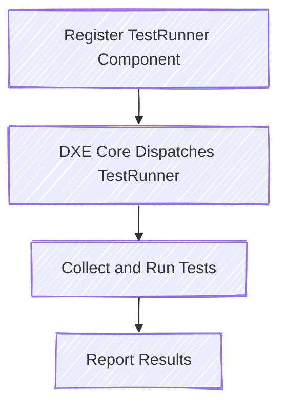

# Platform Testing

Platform testing is supported through the `patina_test` crate, which provides a testing framework similar to
the typical Rust testing framework. The key difference is that instead of tests being collected and executed on the
host system, they are collected and executed via a component (`patina_test::component::TestRunner`) provided by the
same crate. The platform must register this component with the Patina DXE Core, which will then dispatch the component
to run all registered tests.

> **Note:** The most up-to-date documentation on the `patina_test` crate can be found on
> [crates.io](https://crates.io/crates/patina_test). For convenience, some high-level concepts are summarized below.

## Writing On-Platform Tests

Writing a test to be run on-platform is as simple as setting the `patina_test` attribute on a function with the
following interface, where `...` can be any number of parameters that implement the `Param` trait from
`patina::component::*`:

```rust
# extern crate patina_test;
use patina_test::{error::Result, patina_test};

#[patina_test]
fn my_test(/* args */) -> Result { todo!() }
```

On-platform tests are not just for component testing; they can also be used for testing general-purpose code on a
platform. Any function tagged with `#[patina_test]` will be collected and executed on a platform. The test runner
can filter out tests, but you should also be conscious of when tests should run. Using `cfg_attr` paired with the
`skip` attribute is a great way to have tests ignored for reasons like host architecture or feature flags.

> **Note:** `patina_test::error::Result` is simply `core::result::Result<(), &'static str>`, and you can use that
> instead.

This example shows how to use the `skip` attribute paired with `cfg_attr` to skip a test.

```rust
# extern crate patina_test;
# extern crate patina;
use patina::component::service::{Service, uefi_services::protocol::ProtocolServices};
use patina_test::{error::Result, patina_test};

#[patina_test]
#[cfg_attr(target_arch = "aarch64", skip)]
fn my_test(protocols: Service<dyn ProtocolServices>) -> Result { todo!() }
```

Next is the `should_fail` attribute, which allows you to specify that a test should fail. It can also specify the
expected failure message.

```rust
# extern crate patina_test;
use patina_test::{error::Result, patina_test};

#[patina_test]
#[should_fail]
fn my_test1() -> Result { todo!() }

#[patina_test]
#[should_fail = "Failed for this reason"]
fn my_test2() -> Result { todo!() }
```

### Naming and Filtering Tests

Patina provides standard test categories and modifiers with predefined filters. Platforms and component crates
should use these standard names where applicable, but may also define custom category modules and function-name
modifiers. The standard categories are:

- `integration`: verifies interactions across interfaces or components on a platform.
- `stress`: exercises a capability repeatedly or intensively.
- `smoke`: performs a small, basic check of a critical capability.

Name each function for the behavior it verifies. Append optional modifiers to describe execution requirements:

- `_slow`: expected to take substantially longer than typical tests or run repeatedly during boot.
- `_heavy`: requires substantially more resources than typical tests, such as memory or processor capacity.

A test may have multiple standard or custom modifiers: for example, `stress::page_mapping_heavy_slow` uses two standard modifiers, while `security::key_rotation_slow_destructive` uses the standard `_slow` and custom
`_destructive` modifiers in a custom `security` category. Renaming or moving a test changes its reported name; update
external filters that depend on the old path. Tests in other repositories are not automatically classified.

Category filters match complete module segments, including tests in nested modules. Modifier filters inspect the
function name for an underscore-separated word, regardless of order. Consequently, a descriptive name containing
the modifier word also matches; avoid using these words for unrelated purposes. Use `patina_test::category!(security)`,
`patina_test::modifier!(destructive)`, and `patina_test::exclude_modifier!(destructive)` for custom names. These
macros take compile-time identifiers; modifiers must be single words. Category filters are includes; modifier
filters are predicates.

For example, select integration **or** stress tests, then exclude slow and heavy tests:

```rust,no_run
# extern crate patina_test;
use patina_test::component::{Filter, TestRunner};

let runner = TestRunner::default()
    .with_filter(Filter::CATEGORY_INTEGRATION)
    .with_filter(Filter::CATEGORY_STRESS)
    .with_filter(Filter::EXCLUDE_MODIFIER_SLOW)
    .with_filter(Filter::EXCLUDE_MODIFIER_HEAVY);
```

`Filter::CATEGORY_SMOKE` selects smoke tests; `Filter::MODIFIER_SLOW` and `Filter::MODIFIER_HEAVY` select tests
with those modifiers. Category filters and substring includes combine with OR. All modifier requirements and
predicates must pass, so `MODIFIER_SLOW` and `MODIFIER_HEAVY` together select tests with **both** modifiers.
To select either, use one custom predicate. With no category or substring include filters, tests from all
categories, including unclassified tests, remain eligible.

### Test Triggers

There are three supported trigger types for patina_test tests.

#### Immediate

These tests are executed immediately on the `TestRunner` component being dispatched. They are only executed once. This
is the default trigger.

#### Event

These tests are triggered when a given event group GUID is signaled. A separate `on` attribute is used to indicate
this, e.g.:

```rust
# extern crate patina;
# extern crate patina_test;
use patina_test::{error::Result, patina_test};

#[patina_test]
#[on(event = patina::pi::event::END_OF_DXE_EVENT_GROUP_GUID)]
fn my_test() -> Result { todo!() }
```

These tests will be executed every time the event group is signaled.

#### Timer

These tests are executed every specified time interval (in units of 100ns, i.e. timer ticks). The `on` attribute is
also used to indicate this, e.g.:

```rust
# extern crate patina_test;
use patina_test::{error::Result, patina_test};

#[patina_test]
#[on(timer = 1_000_000)] // run every 100 ms
fn my_test() -> Result { todo!() }
```

These tests will continue to execute after the specified time interval for the length of UEFI boot.

## Running On-Platform Tests

Running all these tests on a platform is as easy as instantiating the test runner component and registering it with
the Patina DXE Core:

```rust,no_run
# extern crate patina_test;
# extern crate patina_dxe_core;
use patina_test::component::TestRunner;
use patina_dxe_core::*;

struct ExamplePlatform;

impl ComponentInfo for ExamplePlatform {
    fn components(mut add: Add<Component>) {
        add.component(TestRunner::default());
    }
}
```

This will execute all tests marked with the `patina_test` attribute across all crates used to compile this binary.
Due to this fact, we have some configuration options with the test component. The most important customization is
the `with_filter` function, which allows you to filter down the tests to run. The logic behind this is similar to
the filtering provided by `cargo test`. That is to say, if you pass it a filter of `X64`, it will only run tests
with `X64` in their name. The function name is `<module_path>::<name>`. You can call `with_filter` multiple times.
Include patterns are combined with OR, excludes take priority, and all predicates must return true. Predicates
receive the fully qualified name and accept named functions or non-capturing closures.

The next customization is `debug_mode` which enables logging during test execution (false by default). The final
customization is `fail_fast` which will immediately exit the test harness as soon as a single test fails (false by
default). These two customizations can only be called once. Subsequent calls will overwrite the previous value.

```rust,no_run
# extern crate patina_test;
# extern crate patina_dxe_core;
use patina_test::component::TestRunner;
use patina_dxe_core::*;

struct ExamplePlatform;

impl ComponentInfo for ExamplePlatform {
    fn components(mut add: Add<Component>) {
        add.component(TestRunner::default()
            .debug_mode(true)
        );
    }
}
```


