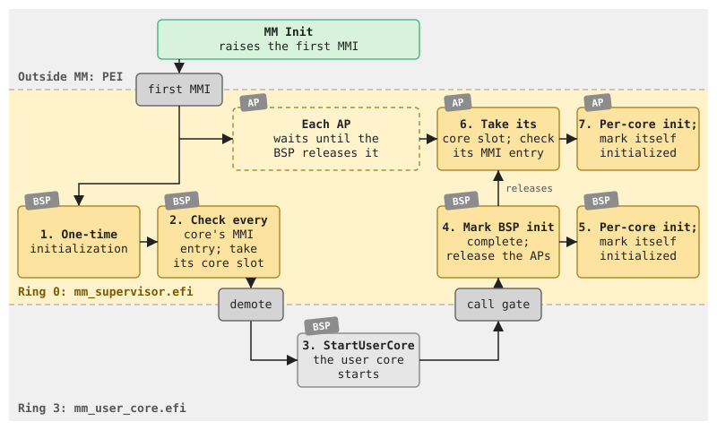
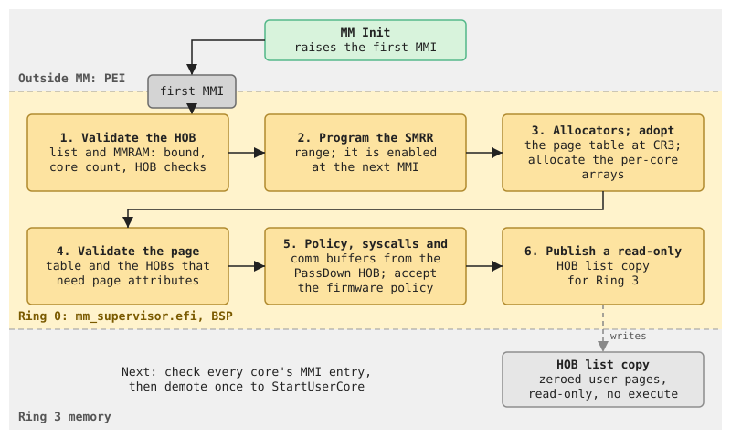

# Initialization

The supervisor has no separate initialization entry point. Every core enters `MmSupervisorCore::entry_point` on every
MMI, with its dense, 0-based core index and the HOB list address that MM Init patched into its MMI entry code. A
per-core flag decides whether the entry is that core's first:

| Core | First entry                                                                                      | Later entries                                                |
| ---- | ------------------------------------------------------------------------------------------------ | ------------------------------------------------------------ |
| BSP  | One-time initialization, MMI entry validation, `StartUserCore` demotion, per-core initialization | SMRR enable, MM Init image release (once), serve the request |
| AP   | Wait for the BSP, register, MMI entry validation, per-core initialization                        | SMRR enable, holding pen                                     |

The BSP flag in the local APIC base MSR identifies the BSP. Later entries go to the runtime, which
[MMI Handling](mmi_handling.md) describes. The per-core flag is that core's slot in the MM-initialized buffer named by
the `PassDown` HOB. The BSP publishes the buffer only after checking that it is in MMRAM and mapped supervisor-only, so
Ring 3 cannot mark a core as initialized; until then every entry is a first entry.

```admonish warning
Any error on a first entry makes the entry point panic. The supervisor does not run on state it could not validate.
```

## The First MMI

MM Init raises the first MMI. The BSP does all one-time work, demotes once to start the user core, and only then
releases the APs. Each AP takes its own first MMI after that and initializes only itself.



Because the BSP has already patched every core's entry, an AP's first entry already loads the supervisor IDT. An AP
fails to register if its core index has no slot or the slot already holds another APIC ID. The HOB list pointer is read
only on the BSP's first entry.

## BSP One-Time Initialization



The order carries the design. Nothing in MMRAM is written until the MMRAM descriptors cover the supervisor's own code
and form one contiguous range. The SMRR range is programmed before the allocator first writes MMRAM, but enabled only
at the next MMI: enabled now, it would stay enforcing after `RSM` and fault the non-MM code that still reaches into it.
The page table is adopted, not built, and new table pages come from the paging pool, so the per-core arrays allocated
after it are mapped supervisor-only. The setup phase also records the user core entry point and the MM Init image
range, and patches every core's MMI entry to load the supervisor IDT. The firmware policy is accepted before anything
can issue a syscall.

The HOB list is copied, not remapped, into zeroed user pages mapped read-only and non-executable, and the original's
whole pages are freed, so the rest of the producer's last page is not exposed. The supervisor does not read the HOB
list again. [Initialization Validation](validation.md) lists what each validation step checks.

## Starting the User Core

The BSP demotes into Ring 3 once during initialization, with the `StartUserCore` command and the HOB list copy, on
this core's Ring 3 stack. `MmUserCore` binds the MM System Table services, enables its heap, discovers the MM drivers
from the HOB list copy, builds the MM System Table, publishes the HOB list as a configuration table and registers its
core MMI handlers. Its page allocations are ordinary syscalls. The status comes back through the call gate and the BSP
logs it.

```admonish note
`StartUserCore` runs no driver and no component. They wait for the first `UserRequest` carrying
`MM_DISPATCH_EVENT_GROUP_GUID`, when every AP is in the rendezvous. See [User Core](user_core.md) and
[Privilege Boundary](privilege_boundary.md).
```

## Per-Core Initialization

Each core's MMI entry is validated first: its entry code and save state window, descriptor tables and TSS, control
registers (including UMIP, SMEP and SMAP), Ring 0 stack and page protections. The BSP also checks every core's entry,
and that no two cores share these structures, before any Ring 3 code runs. Each core then programs its
per-logical-processor MSRs once:

| Step                  | Effect                                                                                                                                        |
| --------------------- | --------------------------------------------------------------------------------------------------------------------------------------------- |
| MSEG base             | Programs the MSEG base from the MSEG SMRAM HOB. Skipped when there is no such HOB; logs a warning when the core lacks VMX                     |
| SMRR                  | Programs the SMRR base and mask from the range the BSP recorded. Fails without MTRR, SMRR or extended SMRR support, or for a misaligned range |
| SMM Code Access Check | Enables and locks the check. Panics when the core does not report support                                                                     |

The SMRR range must be a power of two of at least 4 KiB, aligned to its size, and end at or below 4 GiB. The BSP
programs the same values twice, during one-time initialization and here.

## Releasing the MM Init Image

MM Init raised the first MMI and still runs after it returns, so its image is freed on the next MMI instead. On every
later entry the BSP releases the image before it serves the request. The first release checks that the image range is
inside MMRAM and a page table is installed, then frees the pages: the allocator zeroes them, unmaps them and returns
them to the free pool. Later entries skip the release. Any failure panics.
