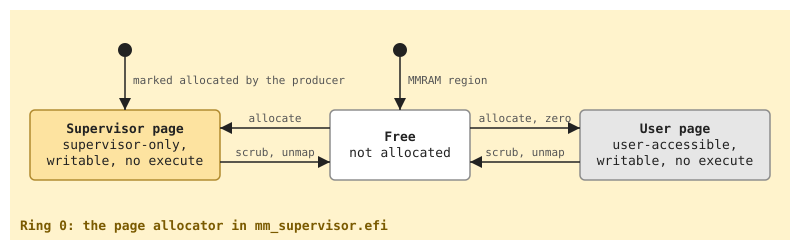
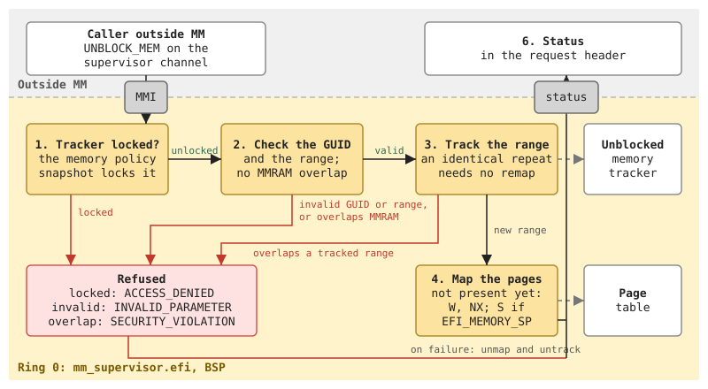

# Memory Management

The supervisor owns MMRAM. It finds MMRAM from the HOB list, proves the HOB list describes the MMRAM it runs in, and
fences it off with the SMRRs. One page allocator hands out the free MMRAM pages and records which ring owns each. The
supervisor adopts MM Init's page table instead of building one, keeping a small pool for the page table pages it adds
later. Outside MMRAM, MM code reaches only memory the page table maps, and the unblocked memory tracker records which
of it MM code may use. The supervisor has no heap: the allocators, the page table and the tracker live in global
supervisor state.

## Initialization Order

The BSP sets up memory management on its first entry, as part of the sequence [Initialization](initialization.md)
describes:

1. Read the MMRAM regions from the HOB list and check that they bound the supervisor's own code.
2. Validate the HOBs that need no page table (see [Initialization Validation](validation.md)).
3. Program the SMRR range, without enabling it, before anything is written into MMRAM.
4. Start the page allocator over the MMRAM regions, then reserve and zero the paging pool.
5. Adopt the page table at CR3, check that the allocator's bookkeeping and the pool are mapped supervisor-only and
   non-executable (the allocator cannot map them itself), and validate the rest of the page table.
6. Seed the unblocked memory tracker from the validated page table.

## MMRAM Discovery and SMRR

The supervisor collects every MMRAM descriptor from the SMRAM and MMRAM reserve GUID HOBs, with whether the producer
marked it allocated (`EFI_ALLOCATED`). It checks them against an address the core proves is MMRAM: a function in the
supervisor image. The regions must contain that anchor and form one contiguous, non-overlapping span at or above
1 MiB. A HOB list that describes MMRAM somewhere else is refused, and a forged one can at most extend the span the
supervisor already runs in.

Every later "inside MMRAM" or "overlaps MMRAM" question is answered against these regions. Until the allocator holds
them, both fail closed: nothing is inside MMRAM and everything overlaps it. A range only partly inside MMRAM is a fatal
error, since neither answer is safe.

The span becomes the SMRR range, which fences MMRAM off from non-MM code. The supervisor requires MTRR, SMRR and
extended SMRR support, and a span whose size is a power of two of at least 4 KiB, aligned to its size and ending at or
below 4 GiB. The BSP programs the range as write-back with the valid bit clear. Every core programs it again on its
first entry, and enables and locks SMM Code Access Check. The valid bit is set on every later MMI entry: enabling the
range during the first MMI would keep it enforcing after `RSM`, faulting non-MM code that still reaches into it. Once
enabled, the registers are left alone.

## Page Allocator

`PageAllocator` manages every MMRAM region at page granularity. Its bookkeeping, a table of the regions and an
allocated bit and an owner bit per page, sits at the start of the first region not marked allocated. Regions the
producer marked allocated, such as the loaded images, the HOB list and the `PassDown` buffers, start as supervisor
allocations, as do the bookkeeping pages. A lock guards the bookkeeping; when the page table lock is needed too, the
bookkeeping lock is taken first.

Every allocation has an owner, and the page table follows it. Both kinds of page are writable and non-executable.



An allocation takes the first run of free pages inside one region, marks it allocated with its owner and maps it; if
the mapping fails the pages are given back. User pages are then zeroed, so Ring 3 never sees what MMRAM held before.

A free holds the bookkeeping lock throughout, and if any step fails the pages stay allocated:

1. Check that every page is allocated, with the expected owner where the caller names one.
2. Remap the pages writable, since inherited mappings such as the HOB list may be read-only.
3. Scrub the pages, then unmap them so any later access faults.
4. Mark them free; only now can another allocation take them.

Before the page table is adopted, allocation and free skip the mapping steps; only the paging pool is allocated that
early.

Supervisor allocations include the per-core storage, the memory policy page and the internal copy of the supervisor
communication buffer. User allocations include the read-only HOB list copy for the user core, the internal copy of the
user communication buffer and every `AllocPage` syscall. On the first runtime MMI the BSP frees the MM Init image; at
the end of its initialization it frees the whole pages of the producer's HOB list.

## Page Table and Paging Pool

MM Init's page table already maps everything the supervisor needs. The supervisor opens the active hierarchy at CR3,
4-level or 5-level as CR4.LA57 selects, as a `patina_paging` page table, and is the only page table manager from then
on.

The paging pool backs the page table pages added when a large mapping is split for a 4 KiB attribute change. It is a
fixed number of pages reserved from the page allocator before the page table exists, handed out in order and never
reclaimed. When it runs out, that attribute change fails.

## Page Ownership

Ownership comes from the page table, not the allocator, so the same query covers MMRAM and the memory outside it. A
range is widened to whole pages and is supervisor-owned or user-owned by its U/S bit. A range that is unmapped, partly
mapped or not mapped uniformly has no owner, and neither does any range before the page table is adopted. Only
`FreePage` asks the allocator.

| Caller                                    | Requirement                                                                               |
| ----------------------------------------- | ----------------------------------------------------------------------------------------- |
| `StartApProc` syscall                     | Procedure and argument pointers are user-owned; the AP demotes a user procedure to Ring 3 |
| `SaveStateRead2` syscall                  | Destination buffer is user-owned and writable                                             |
| `MmMemoryUnblocked` syscall               | Range is user-owned                                                                       |
| `FreePage` syscall                        | Allocator owner is user; a supervisor page returns `EFI_SECURITY_VIOLATION`               |
| Communication buffers                     | External buffers and status mailboxes are supervisor-owned and outside MMRAM              |
| MM-initialized buffer, save state regions | Supervisor-owned                                                                          |

`AllocPage` is accepted only on the BSP, because allocation changes the page table, and only for `AllocateAnyPages`
of `EfiRuntimeServicesData`.

## Unblocked Memory

MM Init maps the regions outside MMRAM that the HOB list names: MMIO and firmware device resource descriptors,
protected regions, the communication buffers, and the unblock region HOBs. An unblock region HOB is a page aligned
range outside MMRAM that names its requester; MM Init maps it supervisor-only when it sets `EFI_MEMORY_SP`. The page
table sweep checks all of these mappings.

The unblocked memory tracker holds a bounded list of regions. It is seeded from a walk of the validated page table that
records every mapped range outside MMRAM, merging neighbors with equal attributes. Later regions arrive through
`UNBLOCK_MEM` requests on the supervisor channel:



The request needs a non-zero requester GUID and a non-null, page aligned range of valid size. A locked tracker returns
`EFI_ACCESS_DENIED`; an overlap with MMRAM or with a tracked range returns `EFI_SECURITY_VIOLATION`. Because a request
can only map pages that were not present, it cannot widen access to memory that is already mapped.

The `MmReadyToLock` handler, or the first `FETCH_POLICY` request if it comes earlier, snapshots the memory policy and
locks the tracker. From then on `UNBLOCK_MEM` is refused and the tracker enforces its list: a range is unblocked only
when one entry contains it.

```admonish note
Before the lock the tracker treats every range as unblocked, so the `MmMemoryUnblocked` syscall checks MMRAM itself. It
reports a range only when the range does not touch MMRAM, the tracker accepts it, and the page table maps it uniformly
as user-owned. It never reports MMRAM.
```
