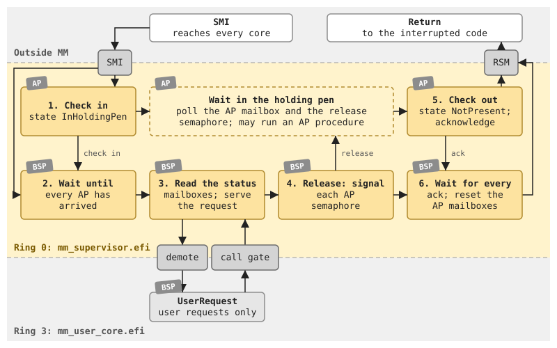
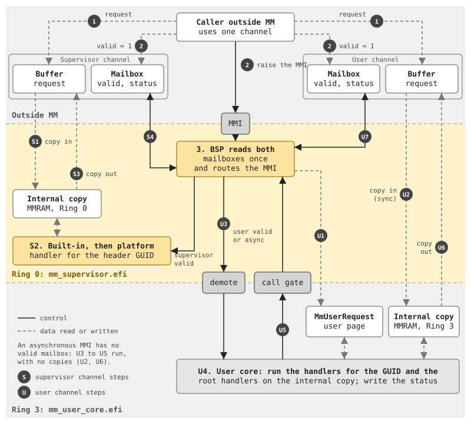
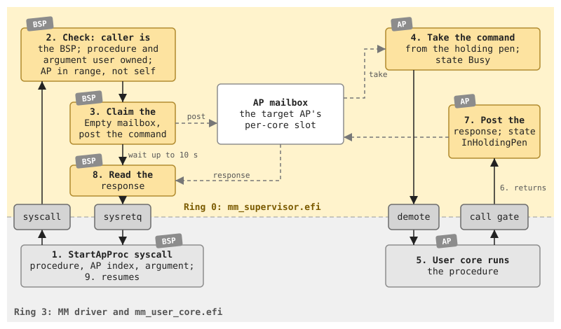
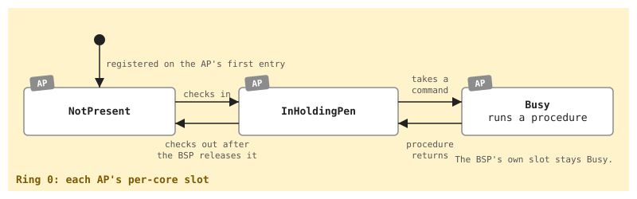
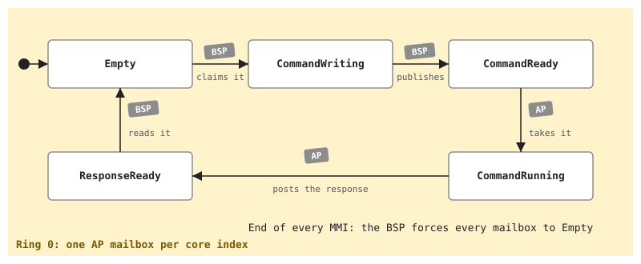

# MMI Handling

After initialization, every MMI follows the same path. Every core enters the supervisor, the APs check in to a holding
pen, the BSP serves the one pending request, and the BSP releases the APs and waits for each to leave before any core
returns. A request goes either to the supervisor, which handles it in Ring 0, or to the user core, which the
supervisor runs in Ring 3. The supervisor never serves a request with only part of the system in MM, and it never
lets a handler work on memory that code outside MM can change during the MMI.

## Rendezvous

The first entry of each core runs initialization only (see [Initialization](initialization.md)). On every later entry
through `MmSupervisorCore::entry_point`, each core activates its SMRR, and on the first runtime MMI the BSP also frees
the MM Init image. The BSP and the APs then take different paths:



The BSP expects one AP fewer than the core count the MP Information HOB reported. An AP checks in only after its
per-core initialization, so a full holding pen means every core is in this MMI. While the BSP serves the request, an
AP in the pen can run an AP procedure (see [AP Procedures](#ap-procedures)). Release and acknowledgement use a counting
semaphore per core.

| Wait                   | Timeout | On expiry                                                  |
| ---------------------- | ------- | ---------------------------------------------------------- |
| APs arrive             | 1 s     | Panic before the request is read                           |
| APs leave the pen      | 1 s     | Panic before the BSP returns                               |
| AP procedure completes | 10 s    | `StartApProc` fails with `TIMEOUT`, and the syscall panics |

```admonish warning
Missing a window halts the system on purpose. A core that has not arrived could be running code outside MM while the
BSP changes MM state, and a core that has not left could still be running in MM after the BSP resumes the platform.
Neither state can be recovered safely. The platform must deliver every SMI to every core (see
[requirements](../integrate/patina_mm_supervisor_requirements.md)).
```

## Communication Buffers

Initialization builds two communication channels. Each has an external buffer outside MMRAM, which the caller outside
MM writes and reads; an internal copy in MMRAM, the only one handlers work on; and an `MmCommBufferStatus` mailbox
outside MMRAM that holds a valid flag, a status and a response size. The external buffer and the mailbox are mapped
for the supervisor only. The supervisor channel comes from the MM Common Region HOB and its internal copy is
supervisor-owned. The user channel comes from the MM Communication Buffer HOB and its internal copy is user-owned.

Initialization rejects an external buffer or mailbox that is at address zero, overlaps MMRAM, is mapped
user-accessible, or is not uniformly mapped. It points the user HOB at the internal copy, so the user core never sees
the external buffer. It also allocates one user-owned page, the supervisor-to-user buffer, which carries each user
request to Ring 3.

The figure follows one request on each channel. Steps 1 to 3 are shared; the supervisor channel continues with S1 to
S4 and the user channel with U1 to U7.



| Step | Where       | What happens                                                                                                   |
| ---- | ----------- | -------------------------------------------------------------------------------------------------------------- |
| 1    | Outside MM  | The caller writes its request into one channel's external buffer                                               |
| 2    | Outside MM  | It sets the valid flag in that channel's mailbox and raises the MMI                                            |
| 3    | Ring 0, BSP | The BSP reads both mailboxes once, with a volatile read; the user mailbox wins if both are valid               |
| S1   | Ring 0      | Zero the internal copy and copy the external buffer in; after Exit Boot Services the request is denied instead |
| S2   | Ring 0      | Check the header and run the first built-in, then platform, handler whose GUID matches                         |
| S3   | Ring 0      | Copy the header and response back to the external buffer                                                       |
| S4   | Ring 0      | Write the mailbox: valid cleared, status and response size                                                     |
| U1   | Ring 0      | Write an `MmUserRequest` (entry context, mailbox copy, internal buffer) into the user page                     |
| U2   | Ring 0      | Synchronous MMI only: copy the external buffer into the internal copy                                          |
| U3   | Ring 0      | Demote to the user core with a user request command; an asynchronous MMI also takes this path                  |
| U4   | Ring 3      | Run the handlers for the request GUID and the root handlers, and write the status into `MmUserRequest`         |
| U5   | Ring 3      | Return to Ring 0 through the call gate                                                                         |
| U6   | Ring 0      | Synchronous MMI only: copy the internal copy back to the external buffer                                       |
| U7   | Ring 0      | Read back only the status, clear valid, reject a response size larger than the buffer and write the mailbox    |

An asynchronous MMI comes from a hardware source or a software SMI with no request. It still demotes to the user core,
which runs its root MMI handlers on every demotion. Before the communication buffers are set up, the BSP serves no
request at all.

## Supervisor Requests

The supervisor channel is served in Ring 0:

1. After `MmExitBootServices`, the request is rejected with `ACCESS_DENIED` without reading the buffer.
2. The supervisor zeroes the internal copy and copies the whole external buffer into it. The buffer must hold an
   `EfiMmCommunicateHeader` whose message length fits the space after it, or the status is `BAD_BUFFER_SIZE`.
3. The first handler whose GUID matches the header runs on the payload. Built-in handlers are searched before
   `PlatformInfo::mmi_handlers`, so a built-in handler wins over a platform handler with the same GUID. With no match
   the status is `NOT_FOUND`.
4. A response larger than the payload space fails with `BAD_BUFFER_SIZE`. Otherwise the header and response are copied
   back to the external buffer. Any handler failure is reported as `NOT_FOUND`.

A platform handler is a `SupervisorMmiHandler`: a name, a GUID and a function that receives the payload and its
length, and returns the response length. The built-in handlers are:

| Built-in handler     | Triggered by                    | Effect                                                        |
| -------------------- | ------------------------------- | ------------------------------------------------------------- |
| `MmReadyToLock`      | MM Ready To Lock notification   | Takes the memory policy snapshot and stops `UNBLOCK_MEM`      |
| `MmSupvRequest`      | MM Supervisor request GUID      | Serves the supervisor request types below                     |
| `MmExitBootServices` | Exit Boot Services notification | Marks the supervisor at runtime, so later requests are denied |

`MmReadyToLock` ignores a repeated notification and panics if the snapshot fails. `MmSupvRequest` expects an
`MmSupervisorRequestHeader` at the start of the payload. A buffer smaller than the header or a wrong signature gets
`INVALID_PARAMETER`, and a revision newer than the supervisor supports gets `UNSUPPORTED`. A request that passes these
checks returns `SUCCESS` to the core and carries its own status in the header result field. An unknown request type
gets `UNSUPPORTED` there.

| Request        | Value | What it does                                                                                                    |
| -------------- | ----- | --------------------------------------------------------------------------------------------------------------- |
| `UNBLOCK_MEM`  | 1     | Maps a region outside MMRAM for MM until the memory policy locks, see [Memory Management](memory_management.md) |
| `FETCH_POLICY` | 2     | Returns the firmware and memory policy, see [Security Policy](security_policy.md)                               |
| `VERSION_INFO` | 3     | Returns `MmSupervisorVersionInfo`: version, patch level and highest request type                                |
| `COMM_UPDATE`  | 4     | Always `ACCESS_DENIED`; the communication buffers are fixed at boot                                             |

## User Requests

The user channel and every asynchronous MMI are served by the user core. The demotion itself is described in
[Privilege Boundary](privilege_boundary.md), and what the user core does with the request in [User Core](user_core.md).
Every access the supervisor makes to user-owned memory runs with user access explicitly enabled.

1. The supervisor writes an `MmUserRequest` into the supervisor-to-user buffer: an `EfiMmEntryContext` with only the
   executing core and the core count filled in, a copy of the mailbox, and the location and size of the internal copy.
2. For a synchronous MMI, it copies the external buffer into the internal copy.
3. It demotes to the user core entry point with a user request command.
4. For a synchronous MMI, it copies the internal copy back to the external buffer.
5. It reads back only the status, so Ring 3 cannot change the buffer location or size the supervisor uses. A response
   size larger than the buffer becomes `BAD_BUFFER_SIZE` with a size of zero.

## AP Procedures

A Ring 3 MM driver runs a procedure on an AP with the `StartApProc` syscall; the user core's `MmStartupThisAp` returns
`UNSUPPORTED`. The BSP issues the syscall while it serves a user request, and the target AP picks the command up from
the holding pen:



The BSP posts a command only for a core index in range, never to itself, and only to an `Empty` mailbox. The syscall
waits for the response, so one AP procedure runs at a time. A refused or timed-out `StartApProc` fails the syscall, and
a failed syscall panics. The AP picks the ring from the owner of the procedure address: it demotes for a user-owned
procedure and calls a supervisor-owned one directly. Ring 3 never reaches the direct call, because the syscall refuses
a procedure that is not user-owned.

Each AP's state lives in its per-core slot. The BSP slot stays `Busy` and is never changed.



Each core index has one AP mailbox. Only the side that owns the current state may change it. The BSP claims the mailbox
with a compare-exchange from `Empty`, so two senders cannot interleave a command.



At the end of every MMI, after the APs leave, the BSP forces every mailbox back to `Empty` and clears its command and
response. No command or response carries over to the next MMI.
