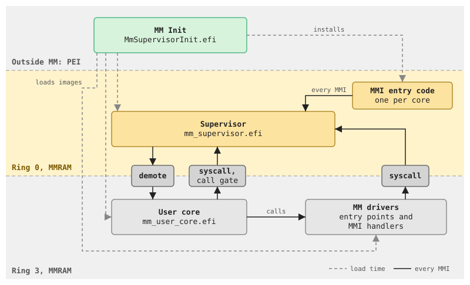
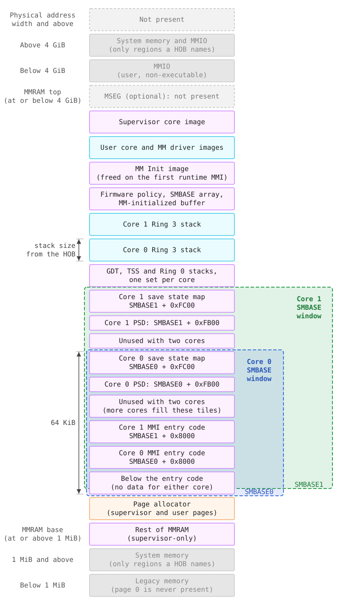
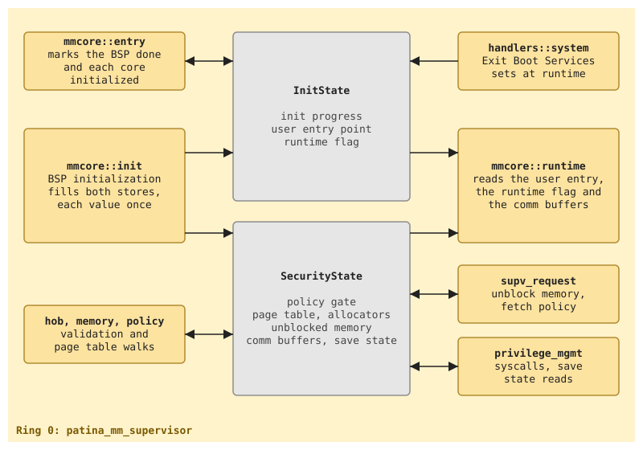

# Theory and Operation

Patina implements Standalone MM as two Rust cores separated by privilege. The MM Supervisor
(`patina_mm_supervisor`) runs in Ring 0 inside MMRAM. It takes over the page table MM Init built and is then the only
code that changes it, and it owns MMRAM allocation, the processors and the security policy. The MM User Core
(`patina_mm_user_core`) runs in Ring 3 together with every MM driver and provides the MM System Table, the protocol
and MMI handler databases and driver dispatch. The split keeps driver code away from MMRAM, MSRs, I/O ports and the
page table: Ring 3 reaches them only through syscalls that the supervisor checks against the firmware security policy.

Both cores are library crates, not images. A platform builds each one into an image with its own small binary crate:
the binary crate links the library, supplies the platform configuration and the function the library's entry shim
calls, and is built for `x86_64-unknown-uefi`. The result is two PE/COFF images, typically named `mm_supervisor.efi`
and `mm_user_core.efi`, which MM Init loads into MMRAM. The crate READMEs show the binary crate for each.

## Construction

Each binary crate holds one `static` instance of its core and exports the function the library's `efi_main` shim
calls. The platform chooses its supervisor MMI handlers through `PlatformInfo` and its user core components through
`MmComponentInfo`; everything else comes from the library.

```rust,ignore
// mm_supervisor.efi
static SUPERVISOR: MmSupervisorCore<Platform> = MmSupervisorCore::new();

fn rust_main(cpu_index, hob_list) {
    SUPERVISOR.entry_point(cpu_index, hob_list)
}

// mm_user_core.efi
static USER_CORE: MmUserCore = MmUserCore::new();

fn user_core_main(op_code, arg1, arg2) -> status {
    USER_CORE.entry_point_worker::<Platform>(op_code, arg1, arg2)
}
```

Neither library installs a logger or a panic handler; each binary crate provides its own. The user core's logger runs
in Ring 3, where every port access faults, so a logger that writes a serial port must use the `IoWrite` syscall, and
the security policy must allow those ports.

## Actors

| Actor                    | Runs in                              | Role                                                                                                                         |
| ------------------------ | ------------------------------------ | ---------------------------------------------------------------------------------------------------------------------------- |
| MM Init                  | PEI phase, started by the PEI MM IPL | Loads the supervisor, user core and MM driver images into MMRAM and prepares the HOB list, page table and per-core MMI entry |
| Supervisor               | Ring 0, MMRAM                        | Validates what MM Init left behind, serves every MMI on every core, and performs privileged operations for Ring 3            |
| User core and MM drivers | Ring 3, MMRAM                        | Runs the MM System Table services, Patina components, MM driver entry points and MMI handlers                                |

MM Init today is `MmSupervisorInit.efi` from
[mu_feature_mm_supv](https://github.com/microsoft/mu_feature_mm_supv). The supervisor does not depend on that image,
only on the state it leaves behind, which the
[requirements](../integrate/patina_mm_supervisor_requirements.md) describe.



MM Init does not stay in control. It raises the first MMI, and from then on the MMI entry code calls
`MmSupervisorCore::entry_point` on every core. The supervisor is the only code that enters Ring 3, and Ring 3 comes
back only through a syscall or the call gate at the end of a demoted routine.

## Cores and Privilege Rings

Every core runs in Ring 0 unless the supervisor demotes it. The BSP and an AP are never in Ring 3 at the same time:
while an AP runs a procedure in Ring 3, the BSP waits in Ring 0 inside the `StartApProc` syscall.

| Core | Ring 0                                                                                                                                                                                                             | Ring 3                                                                                                 |
| ---- | ------------------------------------------------------------------------------------------------------------------------------------------------------------------------------------------------------------------ | ------------------------------------------------------------------------------------------------------ |
| BSP  | - One-time initialization on the first MMI<br/>- The rendezvous on every later MMI<br/>- Every supervisor request<br/>- Every syscall it makes from Ring 3<br/>- Waiting on an AP procedure<br/>- The exit barrier | - `StartUserCore`, once on the first MMI<br/>- Every user request and asynchronous MMI (`UserRequest`) |
| AP   | - Its first entry<br/>- The holding pen<br/>- Every syscall it makes from Ring 3<br/>- The exit barrier                                                                                                            | - Only while running a procedure the BSP sent with `StartApProc` (`UserApProcedure`)                   |

[Initialization](initialization.md) covers the first MMI and [MMI Handling](mmi_handling.md) covers later MMIs.

## Memory Map

A typical physical address map, top to bottom. Rows are not to scale; the dimension lines mark the window and stack
sizes. The order of the regions inside MMRAM varies by platform; only the offsets within each core's SMBASE window are
fixed. Outside MMRAM, a page is present only where a HOB names it.



Each core's SMBASE window is 64 KiB, but MM Init places the SMBASEs one tile apart, typically 8 KiB, so the windows
overlap, as the shaded rectangles show. Inside its window a core uses only its MMI entry code at `SMBASE + 0x8000` and
its PSD and save state map from `SMBASE + 0xFB00` to the end of the window. Other cores' pieces sit between them, and
the lower 32 KiB of the window holds nothing for that core. The processor writes the save state map on every SMI, so no
two cores' entry code, PSD or save state may overlap. [Memory Management](memory_management.md) and
[Initialization Validation](validation.md) describe how each region is mapped and checked.

## Trust Model

| Side       | Trusts                                                                    | Validates                                                                                                                                                           |
| ---------- | ------------------------------------------------------------------------- | ------------------------------------------------------------------------------------------------------------------------------------------------------------------- |
| Supervisor | The core, and the address of its own code as proof of where MMRAM is      | Everything MM Init hands over, once on the first MMI; every request from outside MM, after copying it into MMRAM; every syscall's index, arguments and policy grant |
| User core  | The supervisor, and the read-only HOB list copy the supervisor hands over | The raw arguments of every MM System Table service, and each MMI message against its communication buffer                                                           |
| MM drivers | The user core and the supervisor                                          | Pointers from callers, through `MmIsCommBuffer` and `MmMemoryUnblocked`                                                                                             |

MM Init is checked, not trusted. [Initialization Validation](validation.md) lists every check, and the
[requirements](../integrate/patina_mm_supervisor_requirements.md) page lists what MM Init must provide for them to
pass.

## Crate Map

`patina_mm_supervisor`:

| Module              | Owns                                                                                 |
| ------------------- | ------------------------------------------------------------------------------------ |
| `mmcore`            | The per-core lifecycle: first entry, initialization, runtime, cores and AP mailboxes |
| `hob`               | HOB list validation and the MM Supervisor `PassDown` HOB                             |
| `memory`            | The MMRAM bound, page allocation, the paging pool and page table checks              |
| `policy`            | Firmware policy validation, the `PolicyGate` and the memory policy                   |
| `privilege_mgmt`    | Demotion to Ring 3, the call gate return, syscall dispatch and save state access     |
| `handlers`          | Built-in supervisor MMI handlers and the `SupervisorMmiHandler` type for platforms   |
| `comm_buffer`       | The supervisor and user communication channels                                       |
| `state`             | The supervisor's global state                                                        |
| `error`             | `MmSupervisorError`, the crate's error type                                          |
| `intrinsics`        | Wrappers for privileged instructions                                                 |
| `user_access_guard` | Scoped Ring 0 access to Ring 3 memory                                                |
| `version`           | The version the supervisor reports                                                   |

`patina_mm_user_core`:

| Module                 | Owns                                                          |
| ---------------------- | ------------------------------------------------------------- |
| `lib`                  | `MmUserCore` and the entry protocol from the supervisor       |
| `mm_services`          | The MM System Table services                                  |
| `protocol_db`          | The handle and protocol database                              |
| `mmi`                  | The MMI handler database                                      |
| `mm_dispatcher`        | MM driver discovery and dispatch in dependency order          |
| `component_dispatcher` | The platform's Patina components, from `MmComponentInfo`      |
| `core_handlers`        | The lifecycle MMI handlers the user core registers for itself |
| `config_table`         | The MM configuration table                                    |
| `pool_allocator`       | The global heap allocator                                     |
| `mm_mem`               | Page allocation through syscalls                              |
| `image_name`           | Driver names for dispatch logs                                |

## Global State

The supervisor keeps its global state in two stores, `InitState` and `SecurityState`. Most of it is written once, by
the BSP during initialization, and only read afterwards. One-time values are `Once` cells that ignore later writes;
counters and flags are atomics; the page table and the save state handoff are behind spin locks. The arrows show who
writes, reads, or does both.



The platform's `MmSupervisorCore` static holds the per-core data (core slots, AP mailboxes, Ring 3 stacks and the core
count), and `InitState` records its address so code without a reference can reach it. The allocators, the unblocked
memory tracker and the policy gate are described in [Memory Management](memory_management.md) and
[Security Policy](security_policy.md).

## Design Rules

**No heap in the supervisor.** `MmSupervisorCore::new` is a `const fn`, so the platform declares the supervisor as a
`static`, and the crate has no global allocator. Run-time memory such as the per-core arrays and the HOB list copy
comes from the MMRAM page allocator. The user core has a heap, whose pages come from the supervisor through syscalls.

**Per-core arrays are sized from the MP Information HOB.** The HOB must lie inside MMRAM and report at least one core.
The Ring 3 stacks, the SMBASE array and the per-core initialized slots from the `PassDown` HOB are checked against the
same count. There is no compile-time core limit; a core index outside the arrays is an initialization error.

**Validate before use.** The HOB list headers are checked before anything walks the list, and the MMRAM descriptors
must cover the supervisor's own code before anything in MMRAM is written. Requests from outside MM are copied into
MMRAM before a handler reads them. A Ring 3 pointer is checked for user ownership before Ring 0 touches it, and then
only inside a scoped user access window. The firmware policy is accepted before the first syscall can run.

**Fail secure.** Every fallible step returns a `Result`. The supervisor panics on purpose where continuing would mean
running on state it has not validated, or with part of the system outside its control:

| Panic site              | Trigger                                                                              | Reason                                                         |
| ----------------------- | ------------------------------------------------------------------------------------ | -------------------------------------------------------------- |
| Entry point             | Any error on a core's first entry, in initialization or MMI entry validation         | The supervisor cannot run on state it could not validate       |
| Rendezvous              | An AP misses the arrival or exit window                                              | No request is served, and MM is not left, with cores missing   |
| Syscall dispatch        | A refused or failed syscall, or an unknown syscall index                             | The policy or page ownership forbids the request               |
| Ready to lock           | The memory policy snapshot fails                                                     | Ready to lock must not complete without a locked memory policy |
| MM Init image release   | The image is outside MMRAM, no page table is installed, or its pages cannot be freed | The image must not stay mapped after MM Init is done           |
| Per-core initialization | The core does not report SMM Code Access Check                                       | There is no fallback without it                                |
| MMRAM range check       | A buffer crosses the MMRAM boundary                                                  | A range must be wholly inside or wholly outside MMRAM          |
| Exception handler       | Any CPU exception, in Ring 0 or Ring 3                                               | MM has no recovery path for a fault                            |

```admonish note
Save state read syscalls are the exception to the syscall rule: their failures return a status that `ReadSaveState`
passes to its caller. [Privilege Boundary](privilege_boundary.md) lists each syscall's failure behavior.
```

## Where to Go Next

- [Initialization](initialization.md): the first MMI on the BSP and the APs.
- [Initialization Validation](validation.md): every check made on what MM Init hands over.
- [Privilege Boundary](privilege_boundary.md): demotion, syscalls and Ring 0 access to Ring 3 memory.
- [MMI Handling](mmi_handling.md): rendezvous, communication buffers, supervisor and user requests, AP procedures.
- [Memory Management](memory_management.md): MMRAM, the page allocator, the paging pool and unblocked memory.
- [Security Policy](security_policy.md): the firmware policy, the runtime gate and the memory policy.
- [User Core](user_core.md): the Ring 3 core, the MM System Table and driver dispatch.
