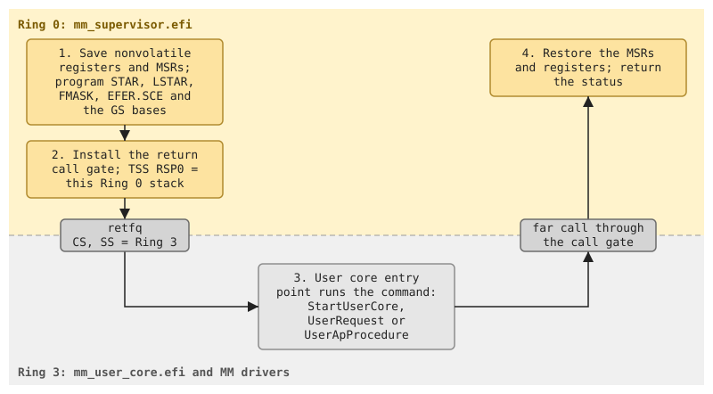
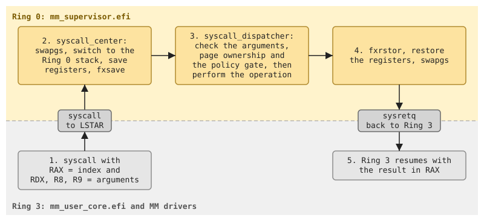

# Privilege Boundary

The supervisor runs in Ring 0 and runs the user core and MM drivers in Ring 3. It enters Ring 3 by demotion: it
programs the syscall MSRs, installs a call gate for the return and transfers to the Ring 3 routine. While Ring 3
runs, every privileged operation is a `syscall` that the supervisor checks against page ownership and the
[security policy](security_policy.md) before it acts. The routine ends by calling back into Ring 0 through the call
gate. The code lives in the `privilege_mgmt` and `user_access_guard` modules.

## Demotion



`privilege_mgmt::invoke_demoted_routine` is the only way into Ring 3. It passes three arguments to the user core
entry point, which acts on the first one. The supervisor demotes in three places:

1. On the first entry of the BSP, to start the user core with the user HOB list.
2. At runtime on the BSP, to hand a user request and its buffer to the user core (see [MMI Handling](mmi_handling.md)).
3. At runtime on one AP, to run an AP procedure that lives in Ring 3 code.

Each core runs Ring 3 on its own CPL3 stack, carved from the stack array the PassDown HOB describes. To demote, the
supervisor saves the nonvolatile registers and the MSRs it changes on the Ring 0 stack, then programs:

- **Syscall entry and flags**: `IA32_STAR` (the Ring 0 and Ring 3 segments for `syscall` and `sysret`), `IA32_LSTAR`
  (the syscall entry point), `IA32_FMASK` (RFLAGS cleared on `syscall`, including DF, AC, IF and TF) and the syscall
  enable bit in `IA32_EFER`.
- **GS for the stack switch**: `IA32_GS_BASE` for Ring 3 and `IA32_KERNEL_GS_BASE`, which points at two slots on the
  Ring 0 stack. After `swapgs`, the syscall entry finds the Ring 0 stack in one and saves the Ring 3 stack pointer in
  the other.

It then writes a call gate, a TSS descriptor and the TSS stack pointer into the GDT the MMI entry code loaded. The TSS
stack is the Ring 0 stack that holds the saved state, so the return lands on it. Finally it loads the Ring 3 data
segments, places the arguments and far returns into Ring 3. A GDT too small for these entries is a fatal error.
While the routine runs in step 3, it may issue any number of syscalls.

## Return Through the Call Gate

When the user core routine finishes, its entry shim far calls through the call gate pointer the supervisor left for
it, carrying the routine's status. A call gate keeps RFLAGS, so the return path first clears DF and AC. It then loads
the Ring 0 data segments before it restores the GS base, because loading GS also reloads the GS base. It restores the
saved MSRs and nonvolatile registers and returns the status to the Rust caller.

## Syscalls



Ring 3 issues syscalls through `patina::management_mode::supervisor::raw_syscall`, which passes a `SyscallIndex` and
up to three arguments and returns one value. The supervisor preserves all other Ring 3 state, FPU and SSE included.

The syscall entry clears DF and AC, runs `swapgs`, switches to the Ring 0 stack and saves the Ring 3 state before it
calls `SyscallDispatcher::dispatch`. The dispatcher decodes the index and calls one handler. Handlers validate their
arguments, check page ownership or ask the [policy gate](security_policy.md), then act only through the `SyscallOps`
trait. `FirmwareOps` runs the privileged instructions and reaches the supervisor state; tests substitute a mock. A
refused save state read returns an error status; any other refusal halts in Ring 0.

| Syscall             | Purpose                                            | What is checked                                                             | On failure     |
| ------------------- | -------------------------------------------------- | --------------------------------------------------------------------------- | -------------- |
| `RdMsr`             | Read an MSR                                        | Gate: MSR policy, read                                                      | Halts          |
| `WrMsr`             | Write an MSR                                       | Gate: MSR policy, write                                                     | Halts          |
| `Cli`               | Disable interrupts                                 | Gate: instruction policy                                                    | Halts          |
| `IoRead`            | Read an 8, 16 or 32-bit I/O port                   | Gate: I/O policy, read                                                      | Halts          |
| `IoWrite`           | Write an 8, 16 or 32-bit I/O port                  | Gate: I/O policy, write                                                     | Halts          |
| `Wbinvd`            | Write back and invalidate the caches               | Gate: instruction policy                                                    | Halts          |
| `Hlt`               | Halt the core                                      | Gate: instruction policy                                                    | Halts          |
| `SaveStateRead`     | Stage a save state read (phase 1)                  | Known register, core index below the core count                             | Returns status |
| `SaveStateRead2`    | Read the staged register and copy it out           | Same core and protocol as phase 1, user writable buffer; gate: save state   | Returns status |
| `AllocPage`         | Allocate pages for Ring 3                          | BSP only, `AllocateAnyPages` of `EfiRuntimeServicesData`, at least one page | Halts          |
| `FreePage`          | Free pages allocated for Ring 3                    | Ownership: every page a `User` allocation                                   | Halts          |
| `StartApProc`       | Run a Ring 3 procedure on an AP                    | BSP only; ownership: procedure and argument user owned; target AP available | Halts          |
| `MmMemoryUnblocked` | Ask whether a range outside MMRAM is unblocked     | Outside MMRAM, inside an unblocked region, user owned                       | Answers FALSE  |
| `MmIsCommBuffer`    | Ask whether a range is in the communication buffer | Inside the MMRAM copy of the user communication buffer                      | Answers FALSE  |

`AllocPage` maps the pages as `User` allocations. `StartApProc` sends the procedure through the AP mailbox and waits
for the AP; see [MMI Handling](mmi_handling.md). Save state reads are described in
[Security Policy](security_policy.md).

### Failure Handling

Save state reads are the only syscalls that report failure to Ring 3: the EFI status comes back as the result, for
`ReadSaveState` to return to its caller. The two buffer queries never fail; they answer FALSE for any range they do
not accept, including an invalid range or a missing communication buffer configuration. Everything else halts in
Ring 0: an unknown index, invalid arguments, a policy denial (`ACCESS_DENIED`), a missing policy gate (`NOT_READY`), a
failed allocation or free, and a `StartApProc` whose AP reports an error, is busy or times out. Ring 3 does not resume
after a refused privileged request.

A CPU exception also ends in Ring 0, whichever ring raised it. The supervisor loads its IDT with default handlers for
every vector: #DF, #GP and #PF log the registers and a stack trace (#PF also logs the page table entries for CR2), and
any other vector logs the same without the page table entries; all of them then panic. So a Ring 3 driver that runs a
privileged instruction, touches a port, or reaches a page it does not own halts the system rather than returning an
error.

## Ring 0 Access to Ring 3 Memory

The MMI entry code turns SMAP on, and the supervisor checks it on each core's first entry (see
[Initialization Validation](validation.md)). Ring 0 therefore faults on any access to a user page unless it opens a
window. Before it opens one, it confirms the target from the page table with `memory::page_ownership`: a range is
`User` or `Supervisor` owned, or not mapped, and a copy out also requires the pages to be writable, so a read-only user
page fails the request instead of faulting. `FreePage` asks the page allocator whether the pages are `User`
allocations.

`user_access_guard::with_user_access` then runs one closure with SMAP access enabled and disables it again when the
closure returns. The supervisor uses it for the save state copy out, the user request hand-off, the user communication
buffer copies, the Ring 3 copy of the HOB list, and zeroing pages that may be user owned.

```admonish warning
`with_user_access` calls must not nest, and the closure must stay on the current core.
```

```admonish note
Every entry into Ring 0 starts with DF and AC clear. The processor clears RFLAGS on MMI entry, FMASK clears them on
`syscall` and the entry repeats the clear, and the call gate return path clears them itself because a call gate
keeps RFLAGS. AC is set only inside a `with_user_access` window.
```
