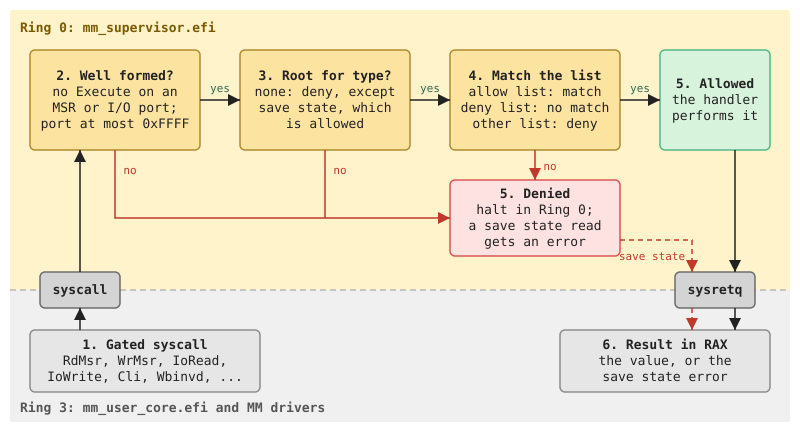
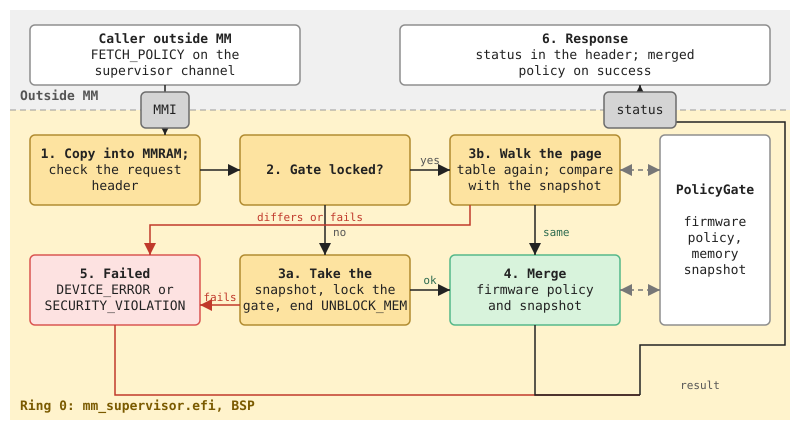

# Security Policy

The security policy decides which I/O ports, MSRs, privileged instructions and save state fields Ring 3 may reach
through syscalls. MM Init passes it as a firmware policy blob in MMRAM, named by the PassDown HOB. The supervisor
validates the blob once during initialization, then consults it through `policy::gate::PolicyGate` on every gated
syscall. The memory policy is not part of the blob: the supervisor builds it from the page table and reports it to
the non-MM environment through `FETCH_POLICY`, merged with the firmware policy.

## Policy Blob

The blob is a `SecurePolicyDataV1_0` header, an array of `PolicyRootV1` policy roots and one descriptor array per root.
Each root names a policy type, locates its descriptor array and marks it as an allow list (`ACCESS_ATTR_ALLOW`) or a
deny list (`ACCESS_ATTR_DENY`). All types live in the `policy` module.

| Type               | Descriptor                  | Describes                                                     | Access attributes         |
| ------------------ | --------------------------- | ------------------------------------------------------------- | ------------------------- |
| `TYPE_MEM`         | `MemDescriptorV1_0`         | Memory ranges, see [Memory Policy](#memory-policy)            | READ, WRITE, EXECUTE      |
| `TYPE_IO`          | `IoDescriptorV1_0`          | I/O port ranges, or exact ports and widths                    | READ, WRITE, STRICT_WIDTH |
| `TYPE_MSR`         | `MsrDescriptorV1_0`         | MSR ranges                                                    | READ, WRITE               |
| `TYPE_INSTRUCTION` | `InstructionDescriptorV1_0` | One of CLI, WBINVD and HLT                                    | EXECUTE                   |
| `TYPE_SAVE_STATE`  | `SaveStateDescriptorV1_0`   | The RAX or IO_TRAP field, unconditionally or on an I/O access | READ, COND_READ           |

The policy is commonly written as XML and converted into the blob at build time by
[SupervisorPolicyMaker.py](https://github.com/microsoft/mu_feature_mm_supv/blob/main/MmSupervisorPkg/SupervisorPolicyTools/SupervisorPolicyMaker.py);
see the
[example policy](https://github.com/microsoft/mu_feature_mm_supv/blob/main/MmSupervisorPkg/SupervisorPolicyTools/MmIsolationPoliciesExample.xml).
The blob ships as a file named `gMmSupervisorPolicyFileGuid`, which MM Init loads (see the
[requirements](../integrate/patina_mm_supervisor_requirements.md#5-security-policy-requirements)).
Each `SmmCategory` (IO, MSR, INSTRUCTION or SAVESTATE) becomes one policy root. Its `PolicyAccessAttribute` makes the
root an allow list when it is `Allow` and a deny list otherwise, and each `PolicyEntry` becomes one descriptor. A
`LimitedRead` entry becomes COND_READ, with its `AccessCondition` as the condition.

## Validation at Initialization

The BSP builds the gate during its first entry, logs the grants described under [Boundary Audit](#boundary-audit),
gives the gate one supervisor page for memory descriptors and installs it once. Any failure panics. The blob must pass:

- **Layout** (`PolicyGate::new`): version 1.0, a size within the buffer the PassDown HOB reports, aligned arrays that
  end inside that size and only recognized root types, so every later descriptor access is in bounds.
- **Content**: zero reserved fields, flags and capabilities; each type at most once; non-empty I/O ranges at or below
  port 0xFFFF; save state descriptors without write access, with COND_READ exactly when a condition is named; no
  legacy memory policy entries; and a declared size equal to the sum of its parts.

See [Initialization Validation](validation.md) and the
[requirements](../integrate/patina_mm_supervisor_requirements.md).

## Runtime Gate

The syscall handlers ask the gate before they touch hardware. A denial returns `ACCESS_DENIED` to the dispatcher, and a
missing gate returns `NOT_READY`; both halt, except for save state reads, as
[Privilege Boundary](privilege_boundary.md) describes.

A request is malformed when it asks to execute an MSR or I/O port, or names a port past 0xFFFF. A descriptor matches
when its attributes include the requested access and the MSR lies in its range, the instruction equals its
instruction, or the save state field matches with READ and no condition or with COND_READ and the current condition.
An I/O range matches on an allow list when it covers every byte of the access and on a deny list when it overlaps any
byte. With STRICT_WIDTH, on either list, the port and the width must equal those of the descriptor.

### Save State Reads

`EFI_MM_CPU_PROTOCOL.ReadSaveState` in the user core makes two syscalls. `SaveStateRead` checks the register and core
index and stages the request in one slot shared by all cores. `SaveStateRead2` requires the same core and protocol,
checks the width and that the output buffer is user owned and writable, then reads the register through the policy and
copies the value out.

The current condition is the I/O trap direction in the save state map. An `Io` read needs a trap and must pass both
the IO_TRAP and the RAX field; a `Rax` read must pass the RAX field. Any other register has no field, so an allow list
denies it and a deny list permits it. `PROCESSOR_ID` comes from the supervisor's core table and skips the policy.

## Memory Policy

The supervisor builds the memory policy from the active page table (four or five levels, as CR4.LA57 selects). It
skips regions entirely inside MMRAM and writes one merged `MemDescriptorV1_0` per run of mapped pages with equal
attributes: READ always, WRITE unless read-only, EXECUTE unless execute-protected. The walk fails if the one-page
descriptor buffer fills. That page seeds the unblocked memory tracker at initialization; the snapshot overwrites it.

`PolicyGate::take_snapshot` takes the snapshot and locks the gate. Whichever comes first takes it and closes
`UNBLOCK_MEM` for good: the `MM_DXE_READY_TO_LOCK_PROTOCOL_GUID` supervisor request (which ignores a repeat and panics
if the gate is missing or the snapshot fails) or the first `FETCH_POLICY`. Every later `FETCH_POLICY` walks the page
table again and requires the same descriptors.

The merged policy is a copy of the firmware blob with the snapshot appended and its `TYPE_MEM` root turned into an
allow list over the snapshot, so the firmware blob must carry a `TYPE_MEM` root; without one the request fails with
`DEVICE_ERROR`. A buffer too small for the result fails with `BUFFER_TOO_SMALL`. The status goes in the result field
of the request header.

## Boundary Audit

`policy::boundary_audit` runs once, when the gate is installed. It asks the gate whether Ring 3 may write each MSR and
I/O port that defines the boundary between Ring 0 and Ring 3, logs an error for each grant and returns the count. It
denies nothing; the gate decides every request as the policy says.

| Group     | Audited for write access                                                                                                                                                              |
| --------- | ------------------------------------------------------------------------------------------------------------------------------------------------------------------------------------- |
| MSRs      | SMBASE, SYSENTER, DEBUGCTL, SMRR, MTRRs and PAT, SMM feature control, RTIT_CTL, DS_AREA, CET and shadow stack pointers, XSS, EFER, STAR, LSTAR, CSTAR, FMASK, GS_BASE, KERNEL_GS_BASE |
| I/O ports | 0xB2 and 0xB3 (software MMI command and data), 0xCF8 to 0xCFF (PCI configuration), each probed at byte, word and dword width                                                          |
