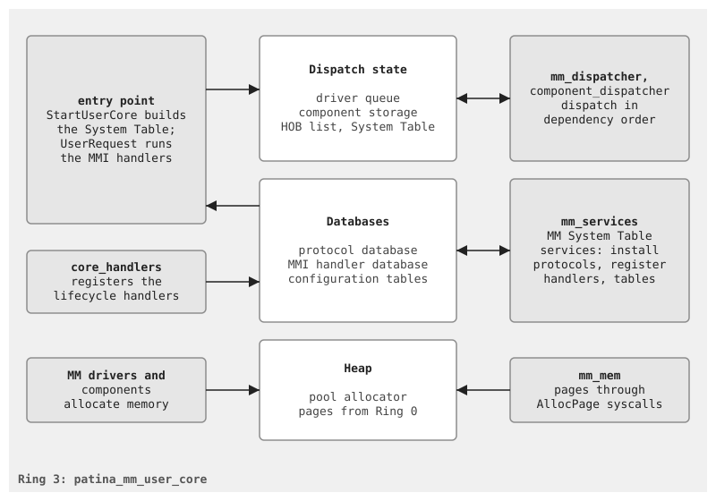
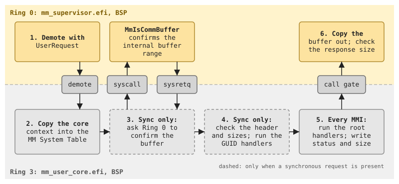
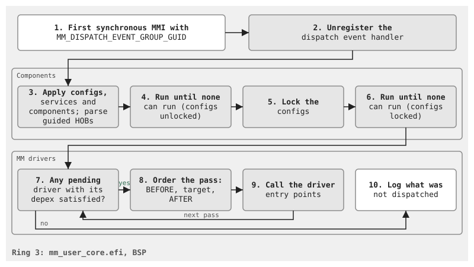
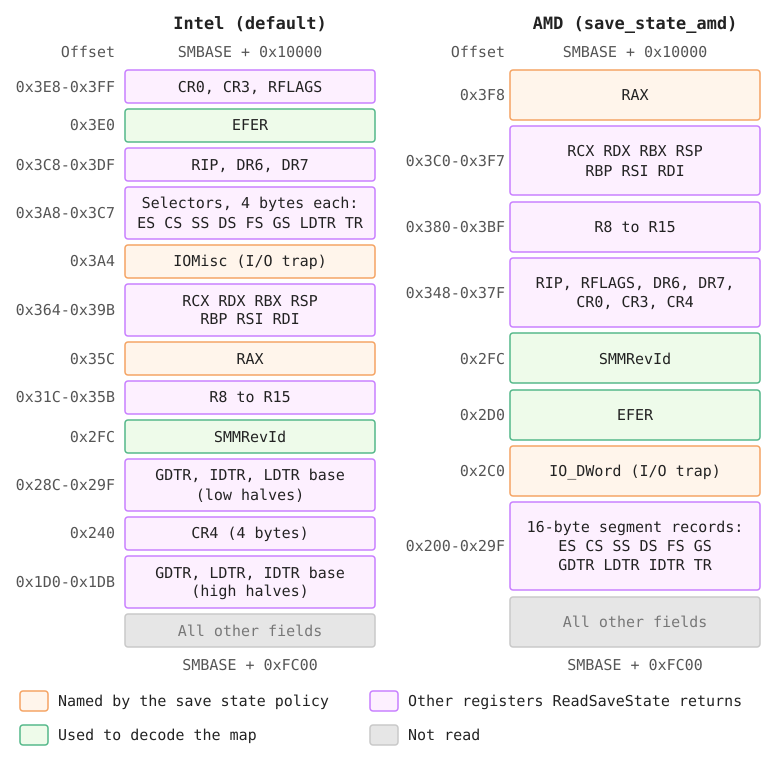

# User Core

The user core (`patina_mm_user_core`) is the Ring 3 half of Patina Standalone MM. It owns everything MM drivers see:
the MM System Table, the protocol and MMI handler databases, configuration tables, driver dispatch and the Patina
component dispatcher. The supervisor controls hardware, the page table and MMRAM, so the user core reaches them only
through syscalls. Running this code in Ring 3 keeps driver bugs and driver-controlled data away from supervisor state.

## Global State

The user core keeps its state in the platform's `static MmUserCore`: the databases MM drivers see through the MM System
Table, and the dispatch state for drivers and components. The heap is a separate global allocator whose pages come
from the supervisor. The arrows show who writes, reads, or does both. The sections below describe each piece.



## Entry Operations

The supervisor enters the user core in Ring 3 with a command and two arguments, and the status returns to Ring 0
through the call gate (see [Privilege Boundary](privilege_boundary.md)). The platform binary keeps one static
`MmUserCore` and exports the entry point that forwards to it. An unknown command returns `INVALID_PARAMETER`.

| Command           | Runs on | Arguments                          |
| ----------------- | ------- | ---------------------------------- |
| `StartUserCore`   | BSP     | User HOB list                      |
| `UserRequest`     | BSP     | `MmUserRequest` buffer and size    |
| `UserApProcedure` | One AP  | Procedure address and its argument |

### StartUserCore

The supervisor sends `StartUserCore` once, at the end of BSP initialization on the first MMI. The user core rejects a
second start with `ALREADY_STARTED` and a null HOB list with `INVALID_PARAMETER`. It then enables page syscalls and
the heap, records the MM drivers in the HOB list, builds the MM System Table, installs the HOB list as the first
configuration table and registers the [lifecycle handlers](#lifecycle-handlers). No component or driver runs yet.

### UserRequest

Every MMI that targets the user core arrives on the BSP as `UserRequest`. The `MmUserRequest` buffer carries the
executing core, the number of cores, the communication buffer status and the internal communication buffer, into which
the supervisor has already copied any synchronous request.



A V3 header dispatches on its message GUID and a legacy header on its header GUID. A failed buffer check, size check
or GUID dispatch records `NOT_FOUND` for the caller, and a response larger than the buffer fails with no data. Root
handlers run regardless, and the command returns `SUCCESS`. [MMI Handling](mmi_handling.md) covers the supervisor side.

### UserApProcedure

After a `StartApProc` syscall names a procedure in user-owned memory, the supervisor demotes the target AP with
`UserApProcedure`. The user core rejects a null procedure, otherwise calls it with the EFIAPI convention and returns
`SUCCESS`. The procedure runs concurrently with other cores and must synchronize shared state itself.

## MM System Table

Each MM System Table entry is an EFIAPI thunk that checks its raw pointers and forwards to the `MmServices`
implementation on `MmUserCore`. Rust code, including components through `MmServiceProvider`, calls the trait
directly. Protocol, MMI handler and configuration table services stay entirely in Ring 3. Page services make one
`AllocPage` or `FreePage` syscall per call, and pool services use the heap, which makes them per block. These services
differ from the PI definition:

| Service or field                   | Behavior                                                                            |
| ---------------------------------- | ----------------------------------------------------------------------------------- |
| `MmIo`, `MmStartupThisAp`          | Return `UNSUPPORTED`                                                                |
| `MmAllocatePages`                  | `AllocateAnyPages` only, others return `UNSUPPORTED`; memory type ignored           |
| `MmAllocatePool`                   | Pool type ignored; 8 byte alignment; size 0 is `INVALID_PARAMETER`                  |
| All allocations                    | Runtime services data, at an address chosen by the supervisor                       |
| `MmLocateHandle`                   | `AllHandles` and `ByProtocol` only, others return `UNSUPPORTED`; search key ignored |
| `MmLocateProtocol`                 | Registration argument ignored; returns the first interface found                    |
| `MmInstallConfigurationTable`      | Table size ignored                                                                  |
| `CpuSaveStateSize`, `CpuSaveState` | Null; use `EFI_MM_CPU_PROTOCOL` (see [Core Save State](#core-save-state))           |

## Protocol Database

The protocol database implements the MM protocol handler services: handles, the interfaces on them, and protocol
notifications.

A handle is an opaque, non-zero id assigned in increasing order, so enumeration follows creation order. It is never a
pointer. A handle carries at most one interface per GUID: installing on an unknown handle or adding a GUID the handle
already carries returns `INVALID_PARAMETER`. Uninstall needs the matching interface pointer, and a handle disappears
with its last protocol.

`MmRegisterProtocolNotify` returns a token for a GUID and callback. The same pair returns the same token, and a null
function with that token unregisters it. Callbacks are EFIAPI functions for drivers or Rust callbacks for components,
and fire only for installs after the registration. They run after the database releases its lock, so they may use the
database. The set of installed GUIDs is what driver depex is evaluated against.

## MMI Handler Database

Root handlers run on every MMI; other handlers are registered for a GUID. Drivers register external handlers through
the MM System Table, and the core registers internal Rust handlers for its own events. A dispatch, from `MmiManage` or
a `UserRequest`, works in three phases so that handlers can register and unregister handlers, including themselves:

1. Under the lock, increase the nesting depth and snapshot the matching handlers not marked for removal.
2. Without the lock, call each handler in the snapshot, skipping one unregistered since the snapshot.
3. Under the lock, decrease the depth; at depth zero, remove the marked handlers and empty GUID entries.

Unregistering during a dispatch only marks the handler (a second unregister returns `INVALID_PARAMETER`), and a newly
registered handler first runs on the next dispatch. A GUID dispatch stops at the first handler that returns `SUCCESS`
or `INTERRUPT_PENDING`; a root dispatch calls every handler. The result is `SUCCESS` if any handler succeeded or
returned `WARN_INTERRUPT_SOURCE_QUIESCED`, otherwise a pending status if one was returned, otherwise `NOT_FOUND`.

## Configuration Tables

A non-null table adds or replaces the entry for its GUID, a null table deletes it, and deleting a missing GUID returns
`NOT_FOUND`. The HOB list is the first entry.

```admonish warning
Every change publishes a fresh copy of the table array in the MM System Table and frees the old copy. A reader must not
keep the array pointer across an install.
```

## Components and Driver Dispatch

Components are Patina `#[component]` entry points linked into the user core binary and supplied by the platform, with
their configs and services, through `MmComponentInfo`. MM drivers are separate images that the supervisor has already
loaded and described in HOBs. Both start on the first synchronous MMI with `MM_DISPATCH_EVENT_GROUP_GUID`, while all
APs wait in the supervisor holding pen, so AP procedures are available.



The handler unregisters itself first, so a nested dispatch event cannot re-enter it, and driver dispatch returns
`ALREADY_STARTED` if re-entered.

### Components

The component dispatcher backs `MmServiceProvider` with the user core, turns guided HOBs into `Hob<T>` values and runs
components as the DXE core does: `ConfigMut<T>` components until none runs, then, after locking the configs, `Config<T>`
components until none runs. Failing components are logged and dropped, and components that never ran are logged with
the reason. Protocols that components install can satisfy driver depex.

```admonish warning
Components are not dispatched again after the drivers. A component that waits on a protocol installed by an MM driver
never runs.
```

### Driver Dispatch

Each driver is described by a memory allocation module HOB named `MM_SUPERVISOR_HOB_MEMORY_ALLOC_MODULE_GUID` (driver
GUID and entry point), optionally followed by a GUID HOB named `MM_SUPERVISOR_DEPEX_HOB_GUID` with its depex. The
supervisor and user core modules are skipped. A driver without a depex is eligible in the first pass; a truncated depex
HOB or one naming another driver drops the driver with an error.

Depex follows the PI specification, including `BEFORE` and `AFTER`. Each pass:

1. Schedules every pending driver whose depex is absent or true against the protocols installed so far.
2. Runs each `BEFORE` or `AFTER` driver right before or after its target when the target is scheduled. Held drivers
   whose target did not run go back to pending.
3. Calls each entry point with a null image handle and the MM System Table. A driver that fails is logged and stays
   resident.

Passes repeat until one schedules nothing. Remaining drivers are logged with their depex as discovered but not
dispatched.

## Lifecycle Handlers

`StartUserCore` registers these internal GUID handlers. The ready-to-lock handler unregisters the ones marked "Retired
at lock", including itself.

| Event GUID                            | Action                                                      | Retired at lock |
| ------------------------------------- | ----------------------------------------------------------- | --------------- |
| `MM_DISPATCH_EVENT_GROUP_GUID`        | Retires itself, runs components, dispatches drivers         | Yes             |
| `MM_DXE_READY_TO_LOCK_PROTOCOL_GUID`  | Retires handlers, installs `MM_READY_TO_LOCK_PROTOCOL_GUID` | Yes             |
| `MM_END_OF_PEI_PROTOCOL_GUID`         | Installs `MM_END_OF_PEI_PROTOCOL_GUID`                      | Yes             |
| `END_OF_DXE_EVENT_GROUP_GUID`         | Installs `MM_END_OF_DXE_PROTOCOL_GUID`                      | No              |
| `EXIT_BOOT_SERVICES_EVENT_GROUP_GUID` | Installs the same GUID as a protocol, once                  | No              |
| `READY_TO_BOOT_EVENT_GROUP_GUID`      | Installs the same GUID as a protocol, once                  | No              |

Each protocol is installed with a null interface on a new handle, so drivers can wait on it with a depex or a protocol
notification. A failed "once" install is retried on the next event.

## Memory

Page requests become `AllocPage` syscalls (runtime services data, any address) and frees become `FreePage` syscalls,
whose failure status reaches `MmFreePages`. Both fail until `StartUserCore` enables them. See
[Memory Management](memory_management.md) for the supervisor side.

The heap is the Rust global allocator, built on these pages. It bump-allocates from page blocks with at least 16 byte
alignment, gives an oversized request its own block, does not reuse freed space within a block, and returns a block to
the supervisor once none of its allocations is live.

`MmAllocatePool` uses the same heap and puts a header with a signature and size before the buffer, because `MmFreePool`
receives no size. `MmFreePool` rejects a pointer without a live signature with `INVALID_PARAMETER` and clears the
signature, so a double free fails the same way.

## Core Save State

The MM System Table save state fields are null because the save state lives in supervisor-only MMRAM. Instead, the
`patina_mm_cpu` component (`MmCpuComponent`) installs `EFI_MM_CPU_PROTOCOL` before driver dispatch. `ReadSaveState`
uses the `SaveStateRead` and `SaveStateRead2` syscalls, and the supervisor applies the save state policy (see
[Security Policy](security_policy.md)). `WriteSaveState` returns `UNSUPPORTED`. A platform whose drivers use the
protocol adds the component to its `MmComponentInfo`.

The save state map is the 1 KiB the processor writes at `SMBASE + 0xFC00` on every SMI. The supervisor reads it in the
Intel layout, or in the AMD layout when built with the `save_state_amd` feature. The figure shows only the fields the
supervisor reads, with offsets from `SMBASE + 0xFC00`; rows are not to scale.


