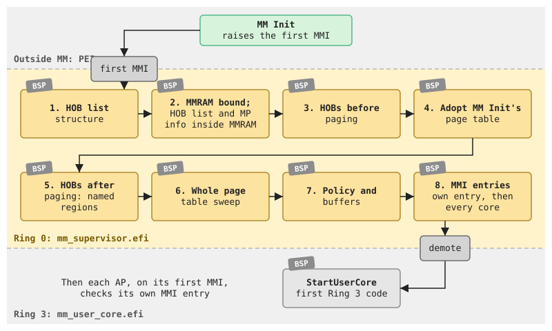

# Initialization Validation

The supervisor runs on state MM Init leaves behind: the HOB list, the page table, the loaded images, the MMI entry
code, and each core's GDT, TSS and stacks. It does not rebuild that state. The BSP validates it during initialization,
before any Ring 3 code runs, and every failure stops the boot: `MmSupervisorCore::entry_point` turns the error into a
panic.

The supervisor adopts MM Init's page table and checks it rather than building its own. Every check uses data that
already exists: the HOB list, the `PassDown` HOB, the MMI entry fixups, the processor SMM descriptor (PSD), the GDT and
TSS, and core state; no HOB fields exist only for validation. Images are checked page by page from their allocation
HOBs, so Ring 0 does not parse PE headers. Anything inside MMRAM that the supervisor cannot name must be
supervisor-only and non-executable, which replaces the need for per-allocation owner and type data. SEA checks some of
the same state later, as a second opinion; nothing here relies on it.

## When the Checks Run

The BSP runs the checks in phases on its first entry. Each phase reads only state an earlier phase has proven: the HOB
headers are checked before any HOB is read, and the HOBs before anything is written into MMRAM. Checks that need page
attributes wait until the page table is adopted. Each AP checks its own MMI entry on its first entry, after the BSP
finishes.



## HOB List

- **Structure:** the first HOB is the PHIT, every HOB length is a multiple of eight bytes and at least the size of its
  type, and the list ends within a fixed size bound.
- **MMRAM:** the regions in the SMRAM reserve HOBs form one contiguous, non-overlapping span at or above 1 MiB that
  holds the supervisor's own code. The HOB list and the MP Information HOB payload lie inside it, and no memory
  allocation HOB overlaps it.
- **Module HOBs:** MM Init, the supervisor core and the user core are each described exactly once. Every module
  allocation lies inside MMRAM, is page aligned, overlaps no other, and holds its entry point.
- **Resource descriptors:** none overlaps another in the same address space; memory bin descriptors are skipped. One
  system or reserved memory descriptor holds all of MMRAM, so no MMIO or firmware device descriptor reaches into it.
  A V2 memory descriptor carries exactly one cacheability attribute and no `EFI_MEMORY_UCE`; a V2 I/O descriptor
  carries none. Only V2 descriptors are checked, or only V1 with the `v1_resource_descriptor_support` feature.
- **`PassDown` HOB:** the revision matches. Its buffers, sized for the core count, lie in MMRAM pages the producer
  marked allocated. No two of them, the module allocations, the HOB list, the SMBASE area and MSEG share a page. The
  Ring 3 stacks and the SMBASE array are page aligned, and no core's SMI entry code, SMM descriptor or save state
  overlaps another core's. The MM-initialized buffer and every save state region must be mapped supervisor-only.
- **MSEG HOB:** when present, it describes a non-empty, page aligned MSEG below 4 GiB.
- **Unblock region and protected region HOBs:** each is non-empty, page aligned and outside MMRAM. Unblock regions name
  their requester with a non-zero GUID. Protected regions are of the IOMMU type only.
- **CPU HOB:** the physical address width does not exceed the processor's MAXPHYADDR.
- **Communication buffers:** the external buffers and status mailboxes lie outside MMRAM and are mapped supervisor-only.

## Named Regions in the Page Table

Once the page table is adopted, each region a HOB names is checked page by page. S is supervisor-only, U
user-accessible, NP not present. No page may be both writable and executable, and every SMBASE must be page aligned.
Each core's SMI entry code starts at `SMBASE + 0x8000`; its SMM descriptor and save state sit at the top of the same
64 KiB window.

| Region                                                                | Required                                                                             |
| --------------------------------------------------------------------- | ------------------------------------------------------------------------------------ |
| Supervisor core                                                       | S, present; entry point on a read-only, executable page                              |
| User core and MM drivers                                              | U, present; entry point on a read-only, executable page                              |
| MM Init image                                                         | S, present. The entry point is not checked: MM Init never runs under this page table |
| Each core's SMI entry code                                            | S, read-only, executable                                                             |
| Each core's SMM descriptor and save state                             | S, non-executable                                                                    |
| Firmware security policy                                              | S, read-only, non-executable                                                         |
| SMBASE array                                                          | S, non-executable                                                                    |
| MM-initialized buffer                                                 | S, writable, non-executable                                                          |
| Ring 3 stacks                                                         | U, writable, non-executable                                                          |
| MSEG                                                                  | NP                                                                                   |
| Page 0, and the lower canonical half above the physical address width | NP                                                                                   |

## Whole Page Table

The sweep walks every present leaf of the page table in address order. The root at CR3 lies inside MMRAM, and every
leaf is an identity mapping. Rather than check page by page, the sweep merges leaves that are back to back in memory
and carry the same attributes into one run (a blanket, in the code) and checks each run once. For example, two drivers
loaded back to back with the same attributes form one run. A run never crosses an MMRAM edge, so it lies wholly inside
or wholly outside MMRAM; a single leaf that straddles an edge, such as a large page that is partly inside MMRAM, fails.

**Outside MMRAM**, every present page lies in a region a HOB names, with the attributes MM Init gives that region.
Every named region that overlaps a run must allow the run's attributes, and together the regions must cover the whole
run. System memory and the gaps between resource descriptors are therefore not present.

| Source                                        | Required                                                    |
| --------------------------------------------- | ----------------------------------------------------------- |
| MMIO and firmware device resource descriptors | U, non-executable                                           |
| Unblock region HOBs                           | Non-executable; S exactly when the HOB sets `EFI_MEMORY_SP` |
| Communication buffers and status mailboxes    | S, non-executable                                           |
| IOMMU protected regions                       | U, read-only, non-executable                                |

**Inside MMRAM**, no page is both writable and executable. User-accessible pages lie only in the user core, an MM
driver or the Ring 3 stacks. Executable pages lie only in the supervisor core, the user core, an MM driver or the SMI
entry code. Every other page is supervisor-only and non-executable.

The unblocked memory tracker is later seeded from this same page table (see [Memory Management](memory_management.md)).
Nothing between the sweep and that walk maps memory outside MMRAM, so the tracker holds only validated ranges.

## MMI Entry and Per-Core State

Each core's check covers the version 5 MMI entry it arrived through and the state it left. Each structure a fixup
names is shown to lie inside MMRAM before it is read.

- **Placement:** the SMI entry code, PSD and save state, up to the end of the SMBASE window, lie inside MMRAM.
- **Fixups:** the CR3 slot holds the live CR3, the rendezvous slot the supervisor entry point, and the HOB slot the HOB
  list the entry code passed. The SMBASE slot matches the SMBASE array and, when the processor reports it readable in
  SMM, `IA32_SMBASE`. XD is enabled, `MSR_IA32_MISC_ENABLE` support matches the vendor, the 5-level paging flag
  matches CR4.LA57, and the debug, CET and reserved slots are zero.
- **Registers and tables:** IDTR and GDTR hold what the entry code loaded, with the supervisor's limits, and the IDT
  lies inside MMRAM. CR4 has UMIP, SMEP and SMAP set. The GDT and TSS match the template the MMI entry code assembles,
  the TSS directly follows the GDT, and the TSS has no I/O permission bitmap, so every Ring 3 port access faults. The
  PSD carries its signature and the CR3 and GDT descriptor the entry code loads. The slot at the top of the Ring 0
  stack holds the core's index.
- **Page protections:** the entry code is S, read-only and executable. The IDT and the IDT and GDT descriptors are S
  and non-executable. The GDT and TSS are S, read-only and non-executable. The top pages of the Ring 0 and IST1 stacks
  are S, writable and non-executable. IST1 is page aligned and the page that starts at IST1 is not present: it is the
  guard between the exception stack and the Ring 0 stack.

Before any Ring 3 code runs, the BSP also checks every core: all entries load the same CR3, no two cores share a GDT,
a GDT descriptor, a Ring 0 stack or an IST1 stack, and every core's page protections hold.

```admonish note
The page protections of every core cannot wait for each AP's own first entry. Each core's entry code reads its GDT and
writes its stack before it turns paging on, where neither page protection nor SMAP applies.
```

## Requirements on MM Init

These checks pass only when MM Init meets the requirements in section 3 of the
[requirements](../integrate/patina_mm_supervisor_requirements.md) page.

## What Is Left

| Item                  | What is missing                                                                                                                                                                                                                                                                                                           |
| --------------------- | ------------------------------------------------------------------------------------------------------------------------------------------------------------------------------------------------------------------------------------------------------------------------------------------------------------------------- |
| Paging structures     | Only the root is shown to lie inside MMRAM. Not yet checked: every non-leaf entry's target lies inside MMRAM before it is read, and every table page is supervisor-only, non-executable, read-only and outside every named region. This needs `patina_paging` to expose non-leaf entries; its iterator yields only leaves |
| Root self-map entries | Not yet checked: the root has no entry at index 0x1FE or 0x1FF. `patina_paging`'s iterator skips both when 0x1FF points back to the root, so the sweep does not see them. MM Init never creates a self-map                                                                                                                |
