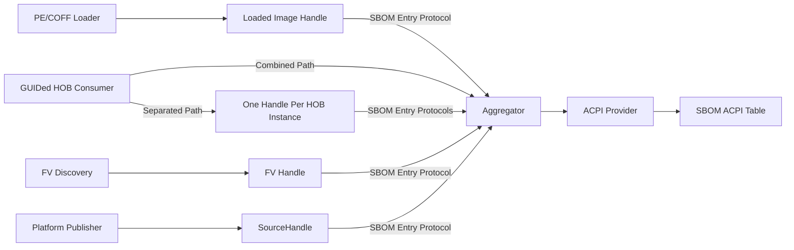

# RFC: `Firmware SBOM Discovery and ACPI Publication`

This RFC proposes a common mechanism for discovering Software Bill of Materials (SBOM) data from
multiple firmware sources and publishing them as an N-entry list in one ACPI SBOM table. Each table
entry contains one standalone SBOM; the individual SBOM payloads are not merged into a single SBOM
document. Independent producers expose discovered entries through an SBOM entry protocol whose
interface represents one serialized ACPI SBOM table entry. A GUIDed HOB consumer that also owns
ACPI table publication may instead add its HOB-derived entries directly to the table collection.
The entry consists of a metadata header prepended to opaque raw SBOM bytes. During boot, firmware
validates only that header and the entry's byte boundaries; it does not decompress, parse, or
semantically validate the raw SBOM. The table publisher copies each entry unchanged into the table
and publishes it through the platform's ACPI implementation. A primary requirement is compatibility
between Patina-based and EDK II-based firmware: every discovery method described by this RFC must
be possible in both implementations, and both implementations must produce the same serialized
entry format. Patina and EDK II may use different internal integration points to perform discovery.

## Change Log

- 2026-10-12: Initial RFC created.

## Motivation

A platform may expose multiple standalone SBOMs originating from different layers of the firmware
build and boot process. The implementation proposed in this RFC collects and publishes those
standalone SBOMs together as an N-entry list in one ACPI SBOM table. It does not build a single SBOM
from the various SBOM sources. The planned discovery mechanisms are:

1. An SBOM entry embedded in a PE/COFF image's `.sbom` section.
2. An SBOM Firmware File System (FFS) file in a firmware volume.
3. SBOM entries passed through a GUIDed Hand-Off Block (HOB).

The RFC also defines a common publication interface through which platform code can expose SBOM
entries obtained by a platform-defined mechanism. The RFC does not prescribe how the platform
discovers those entries.

PE/COFF images and firmware volumes are already parsed by a DXE Core. Discovering their SBOM data in
the core avoids reparsing the same data elsewhere and allows metadata to remain associated with the
object from which it came. Both Patina and EDK II must be able to implement these two discovery paths
without depending on a Patina-specific component model or an EDK II-specific library interface.

GUIDed HOB discovery and the platform publication interface do not require DXE Core changes. A
component or driver that consumes GUIDed HOBs may also own ACPI table publication and contribute
HOB-derived entries directly. If those responsibilities are separated, the HOB consumer publishes
each HOB instance through the common interface.

After discovery, the structurally well-formed entries must be copied unchanged into an ACPI table
for an operating system consumer. Each entry remains a standalone SBOM within the table's N-entry
list. A common handoff between independent producers and the table aggregator is therefore
required. That handoff must:

- Work across Patina and EDK II implementations.
- Be available without introducing an early DXE Core dependency.
- Allow independent producers to contribute entries.
- Preserve each entry until it has been consumed.
- Treat SBOM metadata as optional so failures do not prevent otherwise valid firmware from loading.

## Technology Background

### Firmware SBOMs

An SBOM describes the software components contained in a deliverable. The
[Firmware Embedded SBOM Specification](https://github.com/open-source-firmware/sbom) distinguishes
between an SBOM for one component and the aggregate SBOM for a complete firmware image or platform.
It recommends embedding component metadata in the firmware artifact so the metadata remains paired
with the exact binary that it describes.

For PE/COFF components, the specification identifies `.sbom` as the section used for embedded SBOM
metadata. It also describes volume-level metadata for components that do not have a natural PE/COFF
container. This RFC defines how already-encoded SBOM entries are discovered and transported at
runtime. It does not define how an SBOM payload is generated.

### UEFI Protocol Discovery

UEFI permits the same protocol GUID to be installed on many handles. A consumer can locate all
handles supporting that GUID and process each protocol interface. Only one instance of a protocol
GUID can be installed on a particular handle, but each handle can represent a different producer or
source object.

This model is usually used for device or service interfaces. The protocol proposed by this RFC
instead represents one complete serialized SBOM table entry per protocol instance. It has no
function table and creates no call-time dependency between a producer and the aggregator. Whether
the interface points directly to the serialized entry or contains a pointer and explicit length is
an unresolved design question.

### ACPI Publication

In Patina, the aggregator can publish the completed table using the `AcpiProvider` service proposed
by [RFC 0005](0005-acpi.md). An EDK II implementation can use `EFI_ACPI_TABLE_PROTOCOL`. The producer
protocol and serialized entry format are common to both implementations; only the final ACPI
publication integration is implementation-specific.

## Goals

1. Ensure every SBOM discovery method can be implemented by both Patina and EDK II and produces the
   same serialized entry format.
2. Allow the Patina and EDK II DXE Cores to discover SBOM entries while loading PE/COFF images and
   discovering firmware volumes.
3. Allow a GUIDed HOB consumer either to contribute entries directly when it owns ACPI table
   publication or to use the common publication interface when those responsibilities are
   separated.
4. Publish all available, structurally well-formed SBOMs as independent entries in one ACPI SBOM
   table.
5. Ensure SBOM-specific failures never prevent an otherwise valid image or firmware volume from
   loading.
6. Keep the discovery path independent of payload format and compression.

## Requirements

1. Every discovery method defined by this RFC must be implementable in both Patina-based and EDK
   II-based firmware. The implementations may use different internal integration points, but must
   produce the same serialized `EFI_ACPI_SBOM_TABLE_ENTRY` format.
2. One protocol instance must represent exactly one complete serialized
   `EFI_ACPI_SBOM_TABLE_ENTRY`, consisting of the entry header followed by the opaque raw SBOM
   payload.
3. A producer must structurally validate the entry header, supported revision, header length,
   payload length, checked length arithmetic, and exact serialized entry boundary before installing
   the protocol.
4. Discovery and aggregation must not decompress, parse, or semantically validate the raw SBOM
   payload.
5. A producer must guarantee that the entry bytes exposed or referenced by the protocol remain
   readable for the complete entry length.
6. A producer must own the complete serialized entry for as long as the protocol remains installed.
7. Protocol data must be immutable after installation.
8. Missing, unreadable, malformed, unsupported-revision, or oversized SBOM entries must be
   reported and ignored without failing the image or firmware volume load that discovered them.
9. Allocation failures and SBOM protocol installation failures must also be reported and ignored
   without failing the image or firmware volume load.
10. The PE/COFF discovery path must install a structurally well-formed `.sbom` entry on the loaded
    image handle.
11. The firmware volume discovery path must support at most one SBOM FFS file per firmware volume.
    It must install the discovered SBOM entry protocol on the existing handle supporting
    `EFI_FIRMWARE_VOLUME2_PROTOCOL` for the containing firmware volume.
12. A component or driver that consumes GUIDed HOB instances may also act as the ACPI SBOM table
    collector and publisher. In that combined design, it must add every structurally well-formed
    HOB-derived entry directly to its collection and may skip installing SBOM entry protocols for
    those entries. If the HOB consumer and table publisher are separate, every structurally
    well-formed HOB instance must be exposed through its own SBOM entry protocol installed on a
    distinct handle.
13. Platform implementations using the common publication interface may use an existing source
    handle or create a dedicated handle.
14. The aggregator must locate all SBOM entry protocol instances that are available at its
    collection point and include any GUIDed HOB entries that it consumes directly.
15. The final ACPI SBOM table must be published in `EfiACPIReclaimMemory`. The published table must
    contain owned copies of every entry and must not borrow producer-owned protocol memory.
16. The ACPI table must represent an N-entry list of standalone SBOMs. The aggregator must not merge
    or otherwise combine the raw SBOM payloads into a single SBOM document.
17. ACPI SBOM table publication must occur at one lifecycle event defined by this RFC. The
    publication event must be consistent across implementations and must not be platform-selected.

## Unresolved Questions

The following details are expected to be resolved through this RFC process or follow-up work:

1. Which single lifecycle event should this RFC define as the end of collection and trigger for
   ACPI publication: End of DXE or Ready to Boot?
2. Should an SBOM entry discovered from an image that is later unloaded remain eligible for
   inclusion in the ACPI SBOM table, or should the table contain entries only from images that
   remain loaded at publication time?
3. Should the ACPI table producer be responsible for de-duplicating SBOM entries, or should it
   publish every structurally well-formed entry provided by the discovery mechanisms?
4. Should the SBOM entry protocol point directly to the serialized `EFI_ACPI_SBOM_TABLE_ENTRY` and
   rely on its embedded length fields, or should it be a fixed-size descriptor containing an entry
   pointer and explicit byte length so consumers can bound structural validation independently?
5. What GUID, FFS file type, section type, and payload layout identify an SBOM FFS file?
6. What GUID and payload layout identify a GUIDed HOB containing SBOM data?

The exact FFS and GUIDed HOB encodings are not defined in this RFC. They can be defined after
the common producer-to-aggregator contract is accepted.

The following work is out of scope:

- Generating SPDX, CycloneDX, Concise Software Identification (CoSWID), or vendor-defined payloads.
- Validating payload semantics after decompression.
- Defining an operating system interface beyond the final ACPI table.
- Defining detached or network-retrieved SBOM delivery.
- Requiring every possible firmware component to carry embedded SBOM data.

## Prior Art (Existing PI C Implementation)

There is no existing PI architectural protocol that collects firmware SBOM entries.

The [Firmware Embedded SBOM Specification](https://github.com/open-source-firmware/sbom) provides
the closest prior art for embedding metadata. Its
[embedding guidance](https://github.com/open-source-firmware/sbom/blob/main/source/embedding.rst)
describes `.sbom` PE/COFF sections and volume-level metadata, but it does not define the DXE
producer-to-aggregator interface proposed here.

That guidance describes a `.sbom` section containing the CoSWID payload directly. This RFC instead
proposes that `.sbom` contain a complete `EFI_ACPI_SBOM_TABLE_ENTRY`, including its format and
compression fields. The prepended header allows the DXE Core to validate the entry boundary without
interpreting the opaque payload and allows the aggregator to copy the entry directly into the ACPI
table. The operating system can later use the header to select the payload decompressor and parser.
Tooling that produces or extracts `.sbom` sections must distinguish these encodings.

[RFC 0014](0014-firmware-filesystem-support.md) describes Patina's firmware volume, file, and section
parsing APIs. Those APIs can be used by the Patina DXE Core to discover the future SBOM FFS format.

[RFC 0001](0001-guided-hob-to-hob-param.md) describes Patina's typed GUIDed HOB parsing model. A
component can use that model to parse the future SBOM HOB format. The component may also publish the
ACPI table and contribute the entries directly, or it may install one protocol instance on a
distinct handle for each structurally well-formed HOB entry.

EDK II's
[`EFI_ADAPTER_INFORMATION_PROTOCOL`](https://github.com/tianocore/edk2/blob/05b96e3ccf3fe6b899651d2e245b29a4f7a0e472/MdePkg/Include/Protocol/AdapterInformation.h)
is prior art for associating GUID-typed data with a handle. The EDK II network stack uses it to query
information supplied by network adapters and lower network layers. It is considered as an
alternative below rather than adopted as the SBOM discovery contract.

## Alternatives

### Central Callable SBOM Collector Protocol

A conventional design would have one producer install a protocol with an operation such as
`RegisterEntry()`. Every discovery mechanism would locate that protocol and submit entries to it.
The protocol producer would own the collection and eventually publish the ACPI table.

This design has useful properties:

- The collection has one explicit owner.
- Producers receive immediate registration errors.
- The collector can deduplicate entries and enforce limits as entries arrive.
- Protocol enumeration is unnecessary.

However, PE/COFF and FFS discovery occur in the DXE Core. The collector protocol would need to be
available before the core performs the first relevant image load or firmware volume discovery. A
normal DXE driver cannot satisfy that ordering for images the core loads before dispatching the
driver, including the collector driver itself.

Using a protocol from the DXE Core does not automatically make that protocol a PI architectural
protocol. Architectural protocols are the specific PI-defined protocols with dispatcher and core
semantics. Nevertheless, making this collector an external required dependency would create an
architectural-like bootstrap requirement without a PI-defined contract.

The ordering problem could be avoided by:

- Building and initializing the collector inside each DXE Core.
- Having each core buffer entries until an external collector appears.
- Deferring all discovery to a later driver that reparses images and firmware volumes.

The first two options add a larger core-specific API and state machine than the per-entry protocol.
The third duplicates parsing and can miss transient sources. The callable collector is therefore
not the proposed design.

### Adapter Information Protocol

The UEFI Adapter Information Protocol exposes information blocks identified by GUID and provides
`GetInformation()`, `SetInformation()`, and `GetSupportedTypes()` operations. An SBOM information
type could be defined, and consumers could query that type from handles supporting the protocol.

This reuses a standard protocol but has several disadvantages:

- The protocol is defined for information about an adapter. Loaded images, firmware volumes, and
  GUIDed HOBs are not naturally adapters.
- Every producer would need to implement a callable function table, allocation behavior, supported
  type enumeration, and error handling for immutable data.
- A source handle may already have an Adapter Information Protocol produced by another driver. A
  second producer cannot install the same protocol GUID on that handle, so the implementations
  would need to coordinate and merge supported information types.
- The aggregator would still need to enumerate all Adapter Information Protocol handles and then
  query each handle for SBOM support.
- The generic interface obscures the simple lifetime rule that one protocol interface is one
  serialized ACPI entry.

The Adapter Information Protocol remains useful prior art, especially for GUID-typed information,
but it is not selected for SBOM discovery.

## Rust Code Design

### Proposed ACPI SBOM Table Format

This RFC defines an ACPI SBOM table containing a standard ACPI description header followed by zero
or more variable-length SBOM table entries:

```c
#pragma pack(1)

typedef struct {
  EFI_ACPI_DESCRIPTION_HEADER Header;
  // EFI_ACPI_SBOM_TABLE_ENTRY Entries[];
} EFI_ACPI_SBOM_TABLE;

typedef struct {
  UINT8   Revision;
  UINT16  HeaderLength;
  UINT32  PayloadLength;
  UINT8   Flags;
  UINT8   Format;
  UINT8   Compression;
  UINT8   Payload[];      // Opaque raw SBOM bytes
} EFI_ACPI_SBOM_TABLE_ENTRY;

#pragma pack()
```

The table is a container for multiple independent SBOM documents. Each raw SBOM payload remains a
separate entry for the operating system to process individually.

An SBOM entry header is prepended to the raw SBOM bytes when the firmware artifact is built or
packaged. `HeaderLength` and `PayloadLength` frame the complete serialized entry, while `Format` and
`Compression` tell a later consumer how the opaque payload is encoded. This allows firmware to
transport the entry and copy it directly into the final ACPI table without understanding the SBOM
document.

The initial wire-format values are:

| Field | Value |
|---|---|
| ACPI table signature | `SBOM` |
| ACPI table revision | `0x01` |
| Entry revision | `0x04` |
| Fixed entry header length | `0x000A` |
| Format: CoSWID | `0x00` |
| Format: CycloneDX | `0x01` |
| Format: SPDX | `0x02` |
| Format: vendor-defined | `0xFF` |
| Compression: none | `0x00` |
| Compression: zlib | `0x01` |
| Compression: LZMA | `0x02` |
| Compression: vendor-defined | `0xFF` |

The raw packed structures describe the wire format. Implementations must structurally validate the
entry header and byte boundaries before exposing an entry through the protocol or copying an entry
into a table.

### Structural Validation Scope

In this RFC, validating an SBOM entry means validating only the entry's transport envelope. It does
not mean validating the raw SBOM document contained in `Payload`.

Structural entry validation checks that:

- The fixed header can be read from the available bytes.
- `Revision` is supported.
- `HeaderLength` describes the expected entry header.
- `HeaderLength + PayloadLength` can be calculated without integer overflow.
- The calculated entry length exactly matches the available serialized entry bytes.

Boot firmware does not:

- Decompress the payload.
- Parse CoSWID, CycloneDX, SPDX, or vendor-defined SBOM data.
- Validate the payload against a schema.
- Determine whether the SBOM is complete, accurate, authentic, or applicable to its source.

The firmware preserves the header and opaque payload. An operating system consumer uses `Format`,
`Compression`, and the length fields to select the appropriate decompressor and SBOM parser.

### SBOM Entry Protocol

The current prototype uses the serialized entry itself as the protocol interface rather than a
descriptor containing a second pointer and length:

```c
#define EFI_SBOM_ENTRY_PROTOCOL_GUID \
  { 0x6F84698B, 0xC4E9, 0x4BD0, \
    { 0x9C, 0x8F, 0x5E, 0xB6, 0xC6, 0xF4, 0x68, 0x71 } }

typedef EFI_ACPI_SBOM_TABLE_ENTRY EFI_SBOM_ENTRY_PROTOCOL;
```

The current Patina prototype associates the protocol GUID directly with the unsized raw entry:

```rust
unsafe impl ProtocolInterface for EfiSbomTableEntry {
    const PROTOCOL_GUID: BinaryGuid =
        BinaryGuid::from_string("6F84698B-C4E9-4BD0-9C8F-5EB6C6F46871");
}
```

UEFI stores the interface as a thin `VOID *` to the entry's first byte. A consumer first reads the
fixed header, calculates `HeaderLength + PayloadLength` with checked arithmetic, forms a slice of
that exact length, and structurally parses it as an `SbomTableEntry`.

The protocol pointer does not carry an independently verifiable allocation size. Reading the fixed
header and the declared payload is therefore an unsafe operation whose memory-validity precondition
is guaranteed by the producer contract. Structural parsing remains fallible and checks the entry
revision and lengths, but it cannot prove that an arbitrary firmware-provided pointer addresses its
declared allocation. It also does not establish that the opaque payload is a valid SBOM document.
Whether the final protocol retains this representation or uses a fixed-size pointer-and-length
descriptor is an unresolved question.

A pointer-and-length descriptor would follow an established UEFI pattern. For example,
`EFI_LOADED_IMAGE_PROTOCOL` exposes the loaded image through its `ImageBase` and `ImageSize` fields.

### Producer Contract

A producer follows this sequence:

1. Locate bytes that may contain one SBOM entry.
2. Structurally validate the entry header and exact byte boundary without parsing the payload.
3. Copy the exact serialized bytes into producer-owned storage when the source storage does not
   already have a suitable lifetime.
4. Install the SBOM entry protocol using the representation selected by this RFC. In the current
   prototype, the first byte of the owned entry is the interface pointer.
5. Keep the bytes at a stable address and do not mutate them while installed.
6. Uninstall the exact interface pointer before freeing the bytes.

If any SBOM-specific step fails, the producer logs a warning with source context, discards any
partial SBOM state, and allows the source image or firmware volume operation to continue.

### PE/COFF Discovery

The Patina and EDK II DXE Cores implement the same behavior in their image-loading paths:

1. Parse the source PE/COFF image and search for a section named `.sbom`.
2. If the section is absent, continue without logging an error.
3. If the section cannot be read or is not exactly one structurally well-formed serialized entry,
   log a warning and continue loading the image.
4. Copy the structurally well-formed entry into image-owned memory.
5. Install the protocol on the loaded image handle.
6. If copying or protocol installation fails, log a warning and continue loading the image.
7. On image unload, uninstall the protocol before releasing the entry bytes.

The protocol's lifetime therefore follows the loaded image. Consumers can associate the entry with
the image by querying other protocols on the same handle, such as Loaded Image and Loaded Image
Device Path.

### Firmware Volume Discovery

The Patina and EDK II DXE Cores inspect firmware volumes for the SBOM FFS format. The exact FFS file
GUID, section type, and payload format are follow-up design work.

Only one SBOM FFS file is supported in each firmware volume. When a structurally well-formed entry
is found, its SBOM entry protocol is installed on the existing handle supporting
`EFI_FIRMWARE_VOLUME2_PROTOCOL` for the containing firmware volume.

As with image discovery, every SBOM-specific error is warning-only and must not change the firmware
volume discovery result.

### GUIDed HOB Discovery and Platform Publication

A Patina component or EDK II driver may consume multiple instances of the future SBOM GUIDed HOB
format. Two deployment patterns are supported:

1. **Combined HOB consumer and table publisher:** The component or driver that consumes the HOBs
   also owns collection and ACPI table publication. It adds every structurally well-formed
   HOB-derived entry directly to its collection and does not need to install an SBOM entry protocol
   for those entries.
2. **Separate HOB consumer and table publisher:** The HOB consumer installs one SBOM entry protocol
   for each structurally well-formed HOB instance. Each protocol is installed on its own newly
   created handle, allowing any number of HOB instances to be represented.

The common protocol is also the extension interface through which platform code publishes SBOM
entries obtained by any platform-defined mechanism. This RFC does not prescribe the platform's
discovery implementation. If a platform-defined source already has a stable UEFI handle, the
producer should install the protocol there. Otherwise, the producer creates a new handle by
installing the protocol with a null input handle. The producer may install additional identifying
protocols, such as a device path or a future source metadata protocol, when attribution is required.

### Collection and ACPI Publication

The table collector and publisher is a Patina component or EDK II driver rather than DXE Core
functionality. It may also be the component or driver that consumes GUIDed HOBs:

1. Structurally validate and add any GUIDed HOB entries it consumes directly to the collection.
2. Locate every handle supporting the SBOM entry protocol.
3. Reconstruct each complete serialized entry and structurally validate its header and boundaries.
4. Ignore structurally malformed entries with a warning.
5. Calculate the final table length with checked arithmetic and enforce platform size limits.
6. Construct the complete table image containing the ACPI header and all accepted entries.
7. Copy each accepted entry without modifying its serialized representation.
8. Populate the ACPI header and calculate its checksum.
9. Publish the table through `AcpiProvider` or `EFI_ACPI_TABLE_PROTOCOL`. The ACPI publication layer
   must copy the final table into `EfiACPIReclaimMemory`.



The ACPI publication layer owns the final `EfiACPIReclaimMemory` allocation. Uninstalling a source
protocol after collection cannot invalidate the published table.

### Error Handling

SBOM data is supplemental metadata. It must not become a new failure dependency for `LoadImage`,
firmware volume discovery, driver dispatch, or platform boot.

Producers log and skip failures at the source boundary. The aggregator logs and skips individual
structurally malformed entries so one producer cannot suppress every other well-formed entry. A
failure to allocate or publish the final ACPI table is reported by the aggregator but does not
retroactively fail the operations that discovered source entries.

Implementations must not log payload bytes. Payloads may be large and may contain vendor-specific
information.

## Guide-Level Explanation

An SBOM entry producer does not call a central service. It installs an SBOM entry protocol
representing one immutable serialized entry in the UEFI protocol database.

For a PE/COFF image, the DXE Core looks for `.sbom` while it already has the image bytes available.
If there is no section, loading proceeds normally. If the section cannot be read or is structurally
malformed, the core logs a warning and still loads the image. A structurally well-formed entry is
copied into `PrivateImageData`:

```rust
fn load_sbom_section(&mut self, image: &[u8]) {
    let section = match pecoff::get_section(".sbom", &self.pe_info, image) {
        Ok(Some(section)) => section,
        Ok(None) => return,
        Err(err) => {
            let pe_file_name = self.pe_info.filename_or("Unknown");
            log::warn!("Ignoring {pe_file_name} .sbom section that could not be read: {err:?}");
            return;
        }
    };

    if SbomTableEntry::try_from_bytes(section).is_err() {
        let pe_file_name = self.pe_info.filename_or("Unknown");
        log::warn!("Ignoring invalid .sbom entry in {pe_file_name}");
        return;
    }

    self.sbom_section = Some(section.to_vec().into_boxed_slice());
}
```

`PrivateImageData::install_additional_interfaces` later installs the retained entry as the SBOM
entry protocol on the loaded image handle. Image unload removes that exact protocol interface before
the private entry storage is released.

A Patina component consumes GUIDed HOBs through the dependency-injected `Hob<T>` parameter.
`Hob<T>` retains every parsed instance of the requested HOB type:

```rust,ignore
struct SbomTablePublisher;

#[component]
impl SbomTablePublisher {
    fn entry_point(self, sbom_hobs: Option<Hob<SbomHob>>) -> Result<()> {
        if let Some(sbom_hobs) = sbom_hobs {
            for sbom_hob in &sbom_hobs {
                // Add `sbom_hob` to the collection used to construct the ACPI SBOM table.
            }
        }

        // Continue by collecting protocol-produced entries and publishing the table.
        Ok(())
    }
}
```

Using `Option<Hob<SbomHob>>` allows the table publisher to run when no matching HOB exists.
Iterating `&sbom_hobs` processes every matching GUIDed HOB instance. When the HOB consumer and table
publisher are separate, the consumer uses the same iteration pattern but installs one SBOM entry
protocol on a new handle for each structurally well-formed instance.

At the RFC-defined publication phase, the table publisher combines any GUIDed HOB entries it
consumed directly with all entries found by enumerating the SBOM entry protocol. It structurally
validates each entry header and boundary, copies the header and opaque payload into one ACPI table,
fills in the platform's ACPI header values, computes the checksum, and publishes the result into
`EfiACPIReclaimMemory`. The operating system later interprets each raw SBOM payload according to the
metadata in its prepended entry header. The publication step does not merge the payloads or produce
a new SBOM document.
